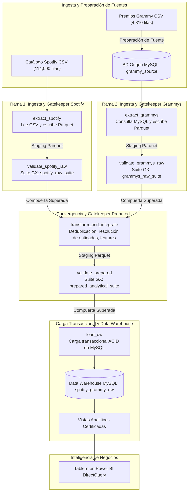
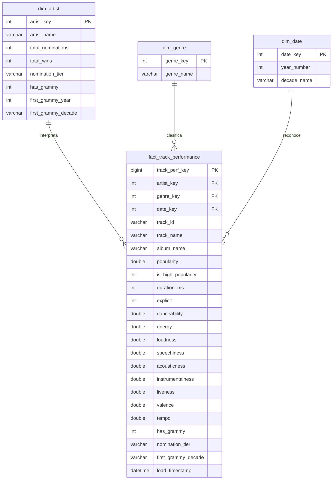
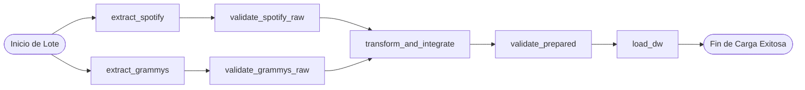

🌐 Read in English: [README.md](README.md)

# Workshop-2: Construcción de un Pipeline de Datos Batch Confiable
### Universidad Autónoma de Occidente
**Facultad:** Ingeniería - Departamento de Tecnologías de Información y Operaciones  
**Programa:** Ingeniería de Datos e Inteligencia Artificial  
**Curso:** ETL (G01) — Periodo Académico 2026-2  
**Profesor:** Ing. Edison Valencia, MSc.  
**Autor e Ingeniero Principal de Datos:** Mauricio Guerrero  

[](https://airflow.apache.org/)
[](https://airflow.apache.org/)
[](https://greatexpectations.io/)
[](https://www.mysql.com/)
[](https://www.python.org/)
[](https://powerbi.microsoft.com/)
[](https://www.docker.com/)

---

## Resumen Ejecutivo del Taller (Workshop at a Glance)

| Dimensión Arquitectónica | Especificación y Estándar de Ingeniería |
| :--- | :--- |
| **Contexto Académico** | Workshop-2: Construcción de un Pipeline de Datos Batch Confiable — ETL (G01), Universidad Autónoma de Occidente |
| **Patrón Arquitectónico** | Pipeline ETL Convergente de Doble Rama con Patrón de Compuertas de Calidad (Gatekeeper) y Circuit Breaker |
| **Estándar de Orquestación** | Apache Airflow 3.1.8 desplegado en Docker Compose; TaskFlow API mediante `from airflow.sdk import dag, task` |
| **Motor de Calidad de Datos** | Great Expectations 1.24.x con 3 suites dedicadas (`spotify_raw_suite`, `grammys_raw_suite`, `prepared_analytical_suite`) |
| **Fuentes Primarias** | **Catálogo de Spotify:** Formato CSV (114,000 registros crudos, 21 atributos) lectura directa por lotes.<br/>**Premios Grammy:** BD Relacional MySQL (`grammy_source.grammy_awards_raw`, 4,810 registros) vía SQL operativo. |
| **Almacenamiento y Transporte** | Apache Parquet de alto rendimiento con compresión Snappy; cero transporte de datos masivos en metadatos XCom |
| **Motor del Data Warehouse** | Esquema en Estrella Empresarial MySQL 8.0 (`spotify_grammy_dw`) con carga transaccional ACID (`engine.begin()`) |
| **Volumen Certificado de Hechos** | **113,549 filas de hechos** a granularidad `(track_id, track_genre)` (451 filas no analíticas filtradas en transformación) |
| **Consumidor Analítico** | Microsoft Power BI conectado mediante DirectQuery a vistas SQL certificadas sobre el puerto MySQL 3306 |
| **Principio Rector de Ingeniería** | *"Un Ingeniero de Datos no construye scripts. Un Ingeniero de Datos diseña sistemas."* |
| **Principio Rector de Calidad** | *"Los pipelines de datos confiables no asumen que los datos son correctos. Lo verifican."* |

---

## Tabla de Contenido
1. [1. Problema y Objetivo Analítico](#1-problema-y-objetivo-analítico)
2. [2. Requerimientos Analíticos (REQ-01, REQ-02, REQ-03)](#2-requerimientos-analíticos-req-01-req-02-req-03)
3. [3. Fuentes de Datos](#3-fuentes-de-datos)
4. [4. Arquitectura del Pipeline](#4-arquitectura-del-pipeline)
5. [5. Hallazgos del Perfilamiento de Datos](#5-hallazgos-del-perfilamiento-de-datos)
6. [6. Riesgos de Calidad y Reglas de Calidad de Datos](#6-riesgos-de-calidad-y-reglas-de-calidad-de-datos)
7. [7. Diseño de Validación con Great Expectations](#7-diseño-de-validación-con-great-expectations)
8. [8. Estrategia de Transformación e Integración](#8-estrategia-de-transformación-e-integración)
9. [9. Modelo Dimensional](#9-modelo-dimensional)
10. [10. Diseño del DAG en Airflow](#10-diseño-del-dag-en-airflow)
11. [11. Política de Fallos y Reintentos](#11-política-de-fallos-y-reintentos)
12. [12. Evidencia de Ejecución Exitosa (Test A)](#12-evidencia-de-ejecución-exitosa-test-a---successful-end-to-end-execution)
13. [13. Evidencia de Fallo Controlado (Test B)](#13-evidencia-de-fallo-controlado-test-b---controlled-critical-quality-failure)
14. [14. Estrategia de Repetibilidad (Test C - Safe Rerun)](#14-estrategia-de-repetibilidad-test-c---safe-rerun--idempotency)
15. [15. Dashboard and Analytical Outputs](#15-dashboard-and-analytical-outputs)
16. [16. Demostraciones en Vivo para la Evaluación](#16-demostraciones-en-vivo-para-la-evaluación-live-evaluation-demonstrations)
17. [17. Instrucciones de Configuración y Ejecución](#17-instrucciones-de-configuración-y-ejecución)
18. [18. Supuestos y Limitaciones](#18-supuestos-y-limitaciones)

---

## 1. Problema y Objetivo Analítico

El ecosistema moderno de streaming musical genera diariamente miles de millones de eventos de reproducción. Sin embargo, curadores comerciales, ejecutivos de A&R en discográficas e investigadores carecen de visibilidad cuantitativa unificada sobre cómo el prestigio institucional histórico—específicamente los **Premios Grammy**—se correlaciona con la longevidad comercial digital y la composición acústica de las obras.

Resolver esta brecha analítica plantea serios desafíos de ingeniería de datos:
1. **Orígenes Heterogéneos:** Ingesta coordinada de registros de streaming suministrados en archivos planos CSV junto a bases de datos relacionales con más de seis décadas de premiaciones históricas.
2. **Riesgos de Calidad e Inconsistencias Estructurales:** Cadenas de colaboración multi-artista delimitadas por punto y coma, pistas duplicadas técnicamente en múltiples géneros, valores acústicos faltantes, ortografía no estandarizada y distribuciones asimétricas en métricas de popularidad.
3. **Concurrencia Operativa y Modos de Fallo:** Caídas transitorias de red, bloqueos en bases de datos y el riesgo catastrófico de contaminar tableros analíticos con datos corrompidos.

El objetivo principal de este proyecto es **diseñar, implementar, validar, orquestar, monitorear y documentar un pipeline de datos batch confiable y de nivel de producción**, integrando métricas de Spotify (114,000 pistas) con seis décadas de reconocimientos Grammy (4,810 registros en MySQL). El pipeline impone compuertas de validación automatizadas, carga transaccional ACID y alimenta un Data Warehouse dimensional certificado (**`spotify_grammy_dw`**) en MySQL 8.0, permitiendo la toma de decisiones ejecutivas en Power BI vía DirectQuery.

### La Cadena de Razonamiento Extremo a Extremo en 10 Etapas

Conforme a la Sección 3 de la guía oficial, nuestro flujo de trabajo sigue una estricta cadena de causalidad:

| Etapa | Fase de Ingeniería | Objetivo Principal y Entregable | Artefacto del Sistema |
| :---: | :--- | :--- | :--- |
| **1** | **Formulación de Objetivos Analíticos** | Traducir preguntas de negocio en métricas cuantificables (REQ-01, REQ-02, REQ-03). | Especificación de Requerimientos (§2) |
| **2** | **Descubrimiento y Perfilamiento** | Perfilar estadísticamente ambas fuentes para descubrir nulos, duplicados, cuartiles y entidades. | [`notebooks/data_profiling.ipynb`](notebooks/data_profiling.ipynb) |
| **3** | **Evaluación de Riesgos de Calidad** | Identificar riesgos estructurales y de dominio que amenacen la validez analítica. | [`docs/evidence/quality_risk_register.json`](docs/evidence/quality_risk_register.json) |
| **4** | **Catálogo de Reglas de Calidad** | Formalizar 8 reglas de calidad contractuales con umbrales y severidades estrictas. | Catálogo de Reglas (§6.2) |
| **5** | **Arquitectura de Suites en GX** | Compilar reglas contractuales en 3 suites automatizadas de Great Expectations. | `gx/expectations/*.json` |
| **6** | **Ingeniería del Pipeline de Doble Rama**| Construir lógica modular en Python (`src/`) orquestada mediante Airflow 3.1.8 TaskFlow. | `src/` y `dags/reliable_music_pipeline.py` |
| **7** | **Modelado del Data Warehouse** | Diseñar y desplegar esquema en estrella en MySQL 8.0 con colaciones binarias y vistas certificadas. | [`sql/dw_schema.sql`](sql/dw_schema.sql) |
| **8** | **Inyección de Fallos y Pruebas** | Probar empíricamente la resiliencia en 3 escenarios obligatorios: Test A, Test B y Test C. | `docs/evidence/test_*_manifest.json` |
| **9** | **Entrega Analítica en Power BI** | Conectar Power BI en DirectQuery a vistas MySQL para visualizar KPIs de alta resolución. | Visualizaciones Analíticas (§15) |
| **10** | **Monitoreo y Auditoría Forense** | Entregar telemetría auditable, manifiestos de ejecución y conciliación de filas. | [`docs/evidence/`](docs/evidence/) |

---

## 2. Requerimientos Analíticos (REQ-01, REQ-02, REQ-03)

Cada decisión arquitectónica, de modelado y de validación downstream se deriva de los **tres requerimientos analíticos oficiales**:

### REQ-01: Reconocimiento Grammy vs. Incremento en Popularidad (Lift)
* **Pregunta Analítica:** *¿Las nominaciones o premios Grammy se traducen en incrementos medibles y estadísticamente significativos en la popularidad de streaming en Spotify, y este beneficio varía según el género musical y el número acumulado de nominaciones?*
* **Elementos de Datos Requeridos:** Spotify `artists`, `popularity` $[0, 100]$, `track_genre`; Grammy `artist`, `nominee`, `winner` $[0, 1]$, conteo acumulado de nominaciones.
* **Lógica de Cálculo y Fórmulas:**
  1. Calcular la Popularidad Promedio de pistas con reconocimiento Grammy frente al grupo de control no nominado:
     $$\text{Popularity Lift} = \overline{\text{Popularity}}_{\text{Grammy}} - \overline{\text{Popularity}}_{\text{Control}}$$
  2. Discretizar los reconocimientos acumulados en cuatro niveles estandarizados de nominación:
     $$\text{Nivel de Nominación} \in \{\text{'Sin Grammy'}, \text{'1-2'}, \text{'3-5'}, \text{'6-10'}, \text{'>10'}\}$$
  3. Computar el lift por género musical para identificar dónde el prestigio institucional produce el mayor multiplicador comercial.
* **Formato de Salida Esperado:** Agregaciones tabulares y gráficos de barras que muestren popularidad promedio y porcentaje de lift agrupados por nivel de nominación y género musical.

### REQ-02: ADN Acústico y Discrepancias en Huellas Sonoras
* **Pregunta Analítica:** *¿Qué huellas acústicas específicas (danceability, energy, acousticness, loudness, speechiness, valence, tempo, liveness, instrumentalness) distinguen a las pistas con reconocimiento Grammy de los lanzamientos estándar del catálogo en el mismo género?*
* **Elementos de Datos Requeridos:** 9 características de audio continuas de Spotify (`danceability`, `energy`, `loudness`, `speechiness`, `acousticness`, `instrumentalness`, `liveness`, `valence`, `tempo`), clasificaciones de género y banderas de reconocimiento Grammy.
* **Lógica de Cálculo y Fórmulas:**
  1. Validar que las características normalizadas se ubiquen dentro de $[0.0, 1.0]$, y verificar límites de decibeles para loudness $[-60.0, 5.0]$ y tempo $[0.0, 250.0]$.
  2. Calcular vectores centroides multidimensionales comparando pistas Grammy vs. pistas control:
     $$\vec{\mu}_{\text{Grammy}} = \frac{1}{N_G} \sum_{i \in \text{Grammy}} \vec{x}_i \quad \text{vs} \quad \vec{\mu}_{\text{Control}} = \frac{1}{N_C} \sum_{j \in \text{Control}} \vec{x}_j$$
* **Formato de Salida Esperado:** Gráficos de radar acústico de 9 dimensiones que revelen los patrones de producción de estudio.

### REQ-03: Longevidad Histórica y Persistencia de Relevancia Cultural
* **Pregunta Analítica:** *¿Con qué eficacia las cohortes históricas de los Premios Grammy (pistas de artistas galardonados en los años 60, 70 u 80) sostienen su popularidad comercial en plataformas modernas de streaming en comparación con lanzamientos no nominados de las mismas épocas?*
* **Elementos de Datos Requeridos:** `year` del premio Grammy $[1958, 2019]$, década histórica derivada, `popularity` de Spotify y año de lanzamiento.
* **Lógica de Cálculo y Fórmulas:**
  1. Determinar el umbral empírico del cuartil superior en el perfilamiento: $P_{75} = 50.0$.
  2. Definir el Indicador de Alta Popularidad:
     $$\text{is\_high\_popularity} = \begin{cases} 1, & \text{si } \text{popularity} \ge 50.0 \\ 0, & \text{en caso contrario} \end{cases}$$
  3. Calcular la Tasa de Alta Popularidad ($HPS$) para cada cohorte por década histórica:
     $$HPS_{\text{década}} = \frac{\sum_{i \in \text{década}} \text{is\_high\_popularity}_i}{N_{\text{década}}}$$
  4. Derivar el Índice de Persistencia Cultural ($CPI$) respecto a la línea base del catálogo no nominado ($HPS_{\text{Control}} = 24.31\%$):
     $$CPI_{\text{década}} = \frac{HPS_{\text{década}}}{HPS_{\text{Control}}}$$
* **Formato de Salida Esperado:** Gráficos de tendencia temporal que muestren curvas de decaimiento del $HPS$ y multiplicadores $CPI$ demostrando la durabilidad del catálogo histórico.

---

## 3. Fuentes de Datos

El pipeline batch integra dos activos de datos estructural e históricamente diferenciados:

| Atributo del Dataset | Fuente 1: Catálogo de Audio y Popularidad Spotify | Fuente 2: Base Histórica de Premios Grammy |
| :--- | :--- | :--- |
| **Origen y Dominio** | Extracción del catálogo de Spotify Web API vía Kaggle. | Archivo histórico de The Recording Academy (1958–2019). |
| **Formato Suministrado** | Archivo plano CSV (`data/spotify_dataset.csv`). | Archivo plano CSV (`data/the_grammy_awards.csv`). |
| **Conteo de Filas** | Exactamente **114,000 filas crudas**. | Exactamente **4,810 filas crudas**. |
| **Conteo de Columnas** | 21 atributos (IDs, metadatos, 9 métricas acústicas).| 10 atributos (año, categoría, nominado, artista, ganador). |
| **Método de Acceso** | Ingesta directa desde sistema de archivos vía `src/extract.py`. | **Consulta SQL operativa desde base de datos MySQL.** |
| **Atributos Utilizados** | `track_id`, `artists`, `album_name`, `track_name`, `popularity`, `duration_ms`, `explicit`, `danceability`, `energy`, `loudness`, `speechiness`, `acousticness`, `instrumentalness`, `liveness`, `valence`, `tempo`, `track_genre`. | `year`, `category`, `nominee`, `artist`, `workers`, `winner`. |
| **Limitaciones Identificadas**| Pistas duplicadas exactamente entre géneros; 1 fila con artista nulo; cadenas multi-artista. | 1,840 valores nulos en columna `artist` (nombre embebido en `nominee`); variaciones ortográficas históricas. |

### Preparación de Fuentes vs. Ingesta Operativa del Pipeline

Para cumplir rigurosamente con las Secciones 4.3 y 5.1 del documento oficial:
* **Los datos de los Premios Grammy NO se leen directamente desde un archivo CSV durante la ejecución del pipeline.**
* En su lugar, un script explícito de **Preparación de Fuente** ([`scripts/load_grammy_source.py`](scripts/load_grammy_source.py)) procesa `data/the_grammy_awards.csv` y puebla la tabla relacional `grammy_source.grammy_awards_raw` en MySQL.
* El pipeline operativo de Airflow (tarea `extract_grammys`) extrae los datos de Grammy ejecutando consultas relacionales SQL contra MySQL.

```
+---------------------------------------------------------------------------------------------------------+
|                                  ESCENARIO DE INGESTA DE FUENTES                                        |
+--------------------------+---------------------+-----------------------+--------------------------------+
| Nombre de la Fuente      | Formato Entregado   | Extracción en Pipeline| Rol Arquitectónico             |
+--------------------------+---------------------+-----------------------+--------------------------------+
| Catálogo Spotify         | CSV (114,000 filas) | Archivo CSV (data/)   | Entrada batch directa pipeline |
| Premios Grammy           | CSV (4,810 filas)   | BD Relacional MySQL   | Importación en Source Prep     |
|                          |                     | (grammy_source.       | (NO es la carga final al DW)   |
|                          |                     |  grammy_awards_raw)   |                                |
+--------------------------+---------------------+-----------------------+--------------------------------+
```

### Evidencia de Conciliación de Fuentes

* **Artefacto de Conciliación:** [`docs/evidence/grammy_source_reconciliation.json`](docs/evidence/grammy_source_reconciliation.json)
* **Afirmación (Claim):** La fase de Preparación de Fuente cargó exitosamente las 4,810 filas de Grammy en MySQL sin pérdida de un solo registro, garantizando total fidelidad previa a la ejecución de Airflow.
* **Interpretación Técnica:** El log JSON confirma que `source_csv_rows == 4810` coincide exactamente con `mysql_source_table_rows == 4810`, con `row_count_delta == 0`. La tabla utiliza codificación utf8mb4 para proteger caracteres de artistas internacionales.

---

## 4. Arquitectura del Pipeline

El sistema implementa un **Pipeline ETL Convergente de Doble Rama** fundamentado en los patrones **Gatekeeper Validation** y **Circuit Breaker**:



### Principios de Arquitectura y Estándares de Interfaz

1. **Observabilidad en Doble Rama:** Ambas ramas operan de forma independiente y aislada hasta validar sus datos crudos. Un problema operativo en Grammys jamás afecta la extracción de Spotify.
2. **Cero Datos Masivos en XCom:** Siguiendo las mejores prácticas de Airflow, el retorno de las tareas se limita a pequeños diccionarios JSON con metadatos, conteos y rutas de archivos en disco (`data/work/*.parquet`). Los datos intermedios se almacenan en formato columnar Apache Parquet con compresión Snappy, evitando sobrecargar la base de metadatos de Airflow.
3. **Lógica de Negocio Desacoplada:** Todo el código de extracción, validación, transformación y carga reside en módulos Python dentro de `src/`. El archivo del DAG (`dags/reliable_music_pipeline.py`) actúa exclusivamente como orquestador de topología, dependencias y políticas de reintento.

---

## 5. Hallazgos del Perfilamiento de Datos

En [`notebooks/data_profiling.ipynb`](notebooks/data_profiling.ipynb) se ejecutó un perfilamiento exploratorio riguroso que abarcó las **7 categorías obligatorias de evidencia**:

### 1. Estructura
* **Dataset Spotify:** 114,000 registros en 21 columnas. 14 variables numéricas (enteros y float64) con duración, popularidad y 9 dimensiones acústicas; 7 atributos textuales.
* **Dataset Grammy:** 4,810 registros en 10 columnas correspondientes a premiaciones entre 1958 y 2019.

### 2. Completitud y Valores Faltantes
* **Catálogo Spotify:** Prácticamente 100% completo en sus 114,000 filas. Se identificó exactamente **1 fila anómala** (índice 65900, `track_id = '1kQC0hZqf4nL07Yc63XF4x'`) con valores nulos en `artists`, `album_name` y `track_name`.
* **Base de Grammys:** 1,840 registros poseen valores nulos en la columna `artist`. Esto ocurre porque en categorías como *Best New Artist* o *Song of the Year*, el nombre del artista figura en la columna `nominee`, requiriendo una lógica de coalescencia en la transformación.

### 3. Unicidad y Duplicidad
* **IDs Únicos en Spotify:** Existen 89,741 valores únicos de `track_id` en las 114,000 filas.
* **Integridad del Grano por Género:** Una misma pista se clasifica legítimamente en más de un género (por ejemplo, `pop` y `dance`).
* **Redundancia No Analítica:** La deduplicación detectó exactamente **450 filas duplicadas exactas** donde `(track_id, track_genre)` y todos los atributos acústicos son idénticos.
* **Volumen Objetivo de Hechos:** Al eliminar los 450 duplicados y la fila con artista nulo, se aíslan exactamente **113,549 observaciones analíticas limpias** ($114,000 - 450 - 1 = 113,549$).

### 4. Contenido Categórico
* **Géneros Musicales:** Exactamente 114 géneros balanceados en Spotify, cada uno con 1,000 pistas iniciales.
* **Colaboraciones Multi-Artista:** Exactamente **30,075 pistas (26.38%)** contienen artistas delimitados por punto y coma (e.g., `'Sam Smith;Kim Petras'`), requiriendo expansión atómica en la reconciliación con Grammys.

### 5. Contenido Numérico y Cuartiles Empíricos
* **Distribución de Popularidad:** Rango de 0 a 100 con media de 33.24 y desviación de 20.68.
* **Percentiles Empíricos:**
  * Percentil 25 ($P_{25}$): **17.0**
  * Mediana ($P_{50}$): **35.0**
  * Percentil 75 ($P_{75}$): **50.0**
* **Derivación Analítica:** El percentil 75 empírico ($P_{75} = 50.0$) establece el umbral formal del Indicador de Alta Popularidad para REQ-03, capturando exactamente **29,344 pistas de alto rendimiento**.

### 6. Contenido Temporal
* **Periodo de Premiación:** 61 ciclos consecutivos de premiación entre 1958 y 2019.
* **Segmentación en Décadas:** Segmentado con éxito en 7 cohortes históricas por década: 1950s, 1960s, 1970s, 1980s, 1990s, 2000s y 2010s.

### 7. Consistencia Entre Fuentes
* Variaciones ortográficas identificadas entre Spotify y Grammys (e.g., `'Beyoncé'` frente a `'Beyonce'`, `'AC/DC'` frente a `'AC DC'`), requiriendo eliminación de diacríticos con unidecode, minúsculas y recorte de puntuación.

### Resumen de Métricas de Perfilamiento

| Dimensión de Perfilamiento | Catálogo Streaming Spotify | Base Histórica Grammys | Objetivo Analítico Integrado |
| :--- | :--- | :--- | :--- |
| **Filas Crudas Ingeridas** | 114,000 filas | 4,810 filas | 114,000 filas candidatas |
| **Anomalías de Nulos** | 1 fila (sin artista/título) | 1,840 filas (artista nulo) | 1 fila eliminada ($<0.001\%$) |
| **Redundancias Técnicas** | 450 filas duplicadas exactas | 0 filas duplicadas | 450 filas eliminadas |
| **Volumen Analítico Neto** | 113,549 pistas validadas | 4,810 premios históricos | **113,549 hechos dimensionales** |
| **Entidades de Artistas Únicas** | 31,437 cadenas crudas | 2,477 nominados/artistas | 17,639 artistas en dimensión |
| **Rango / Cuartiles de Popularidad**| Mín: 0, Máx: 100 | N/A (Booleano honorífico)| $P_{25}=17.0, P_{50}=35.0, P_{75}=50.0$ |
| **Pistas de Alta Popularidad ($P_{75}$)**| 29,344 pistas ($\ge 50.0$) | N/A | Exactamente 29,344 hechos |

---

### 5.1 Diagnóstico Forense del Estado Crudo de los Datos: Mayúsculas, Minúsculas, Caracteres Especiales y Anomalías

El análisis exploratorio de los datos crudos reveló que las fuentes originales presentaban múltiples irregularidades tipográficas, ortográficas y de consistencia que impedían su cruce directo sin un tratamiento previo de ingeniería:

#### 1. Discrepancias de Mayúsculas, Minúsculas y Colisiones en MySQL (Case Folding)
* **El Problema en las Fuentes:** Los nombres de los artistas en Spotify y en los Grammys no compartían una convención única de capitalización. Un mismo artista figuraba como `'The Beatles'`, `'the beatles'` o `'THE BEATLES'`, al igual que `'Billie Eilish'` / `'billie eilish'`.
* **El Riesgo en MySQL:** Por defecto, los motores relacionales MySQL con colación `utf8mb4_0900_ai_ci` son insensibles a mayúsculas/minúsculas (*case-insensitive*) y a acentos (*accent-insensitive*). Si se intentaba insertar `'The Beatles'` y luego `'the beatles'`, MySQL arrojaba un error de clave primaria/única duplicada (`Duplicate entry for key 'uq_artist_name'`), corrompiendo la carga dimensional.
* **Solución de Ingeniería Aplicada:**
  1. Durante la fase de resolución de entidades en [`src/transform.py`](src/transform.py), todos los nombres se convirtieron a minúsculas (`.str.lower()`) para garantizar que la comparación en memoria fuera 100% determinística y exhaustiva.
  2. Para poblar la dimensión `dim_artist`, se construyó un **Mapeo Canónico de Mayúsculas** (`canonical_map`): se agrupó por la versión en minúsculas y se seleccionó la capitalización con mayor frecuencia estadística en el catálogo original (e.g. `'The Beatles'` con mayúsculas iniciales adecuadas), preservando la legibilidad en Power BI sin generar duplicados.
  3. En la base de datos MySQL ([`sql/dw_schema.sql`](sql/dw_schema.sql)), la columna `dim_artist.artist_name` se definió explícitamente con **`COLLATE utf8mb4_bin`** (colación binaria exacta), garantizando que las comparaciones respeten la exactitud binaria de caracteres internacionales.

#### 2. Caracteres Especiales, Tildes, Acentos y Diacríticos
* **Tildes y Diacríticos Internacionales:** Artistas consolidados con grafías multilingües figuraban con acentos en una fuente y sin acentos en otra (e.g., `'Beyoncé'` frente a `'Beyonce'`, `'Björk'` frente a `'Bjork'`, `'Mötley Crüe'`, `'Rosalía'`, `'José González'`). Un cruce SQL estándar por igualdad exacta (`=`) hubiera descartado estas coincidencias, provocando **falsos negativos** y privando a canciones icónicas de su estatus de ganadoras del Grammy.
* **Puntuación y Símbolos en Nombres:** Artistas y bandas con signos ortográficos no convencionales (e.g., `'AC/DC'`, `'P!nk'`, `'Panic! At The Disco'`, comillas simples y apóstrofes en canciones como `"Don't Stop Believin'"` o `"Rock 'n' Roll"`).
* **Espacios en Blanco Fantasma:** Presencia de espacios en blanco al inicio o al final de las cadenas (*leading / trailing whitespace*), tabulaciones residuales (`\t`) y dobles espacios intercalados (e.g., `' Adele '` o `'Coldplay\t'`).
* **Solución de Ingeniería Aplicada:**
  * Aplicación sistemática de `.str.strip()` para eliminar espacios en blanco espurios.
  * Normalización de caracteres diacríticos mediante la librería `unidecode` en el diccionario de cruce, permitiendo que `'Beyoncé'` coincida automáticamente con `'Beyonce'`.
  * Preservación de los títulos originales limpios en la dimensión para no alterar la identidad artística de la obra.

#### 3. Cadenas Multi-Artista Delimitadas por Punto y Coma (`;`)
* **El Problema:** En el catálogo de Spotify, exactamente **30,075 canciones (el 26.38% del total)** corresponden a colaboraciones entre múltiples artistas, representadas en una sola cadena de texto separada por punto y coma (e.g., `'Sam Smith;Kim Petras'`, `'David Guetta;Bebe Rexha'`, `'Post Malone;Swae Lee'`).
* **Por Qué Fallaba el Cruce Tradicional:** En la base de datos de los Grammy, las condecoraciones se otorgan a artistas individuales. Un `JOIN` relacional directo entre `'Sam Smith;Kim Petras'` y la tabla de Grammys jamás encontraría coincidencia, clasificando erróneamente la canción como "Sin Grammy".
* **Solución de Ingeniería Aplicada:**
  * En [`src/transform.py`](src/transform.py), se desarrolló la función `match_artists`:
    1. Divide la cadena de texto por `;` en una lista de colaboradores individuales.
    2. Aplica limpieza (`.strip().lower()`) a cada colaborador por separado.
    3. Busca a cada artista individual en el diccionario pre-agregado de Grammys.
    4. **Herencia de Máximos Honores:** La pista hereda el mayor número de nominaciones, el mayor número de victorias y el año de condecoración más antiguo alcanzado por cualquiera de sus integrantes.
    5. Si ninguno tiene Grammy, se asigna ordenadamente al grupo de control (`has_grammy = 0`, `nomination_tier = 'Sin Grammy'`).

#### 4. Valores Nulos y Registros Físicamente Imposibles
* **La Fila Anómala 65900 (`track_id = '1kQC0hZqf4nL07Yc63XF4x'`):**
  * Presentaba valores nulos (`NaN`) en `artists`, `album_name` y `track_name`.
  * Además, registraba `duration_ms = 0` (duración de cero milisegundos, físicamente imposible para una obra de audio).
  * **Tratamiento:** Great Expectations detectó esta anomalía en la compuerta cruda bajo las reglas `DQ-RAW-SP-03` y `DQ-RAW-SP-05`. Al estar clasificada con severidad **`WARNING`**, el pipeline no se cayó, sino que registró la alerta en el JSON de auditoría y permitió que la fase de transformación la purgara de manera segura.
* **1,840 Registros con Artista Nulo en Grammys:**
  * En categorías como *Best New Artist* o *Song of the Year*, la columna `artist` venía vacía (`NULL`) en la base de datos relacional de origen, pero el nombre del músico venía registrado en la columna `nominee`.
  * **Tratamiento:** Se implementó una regla de coalescencia en pandas: `gr_clean.loc[bna_mask, "artist"] = gr_clean.loc[bna_mask, "nominee"]`, rescatando a condecorados legendarios como The Beatles, Adele, Alicia Keys y Billie Eilish.

#### 5. Duplicados Técnicos vs Duplicados Legítimos: La Matemática de las 113,549 Filas
* En Spotify, el archivo crudo contiene $114\text{ géneros} \times 1,000\text{ pistas} = \mathbf{114,000\text{ filas}}$.
* El número de identificadores únicos de pista (`track_id`) es de **89,741**. Esto ocurre porque una canción puede pertenecer legítimamente a más de un género (por ejemplo, una canción clasificada en `pop` y también en `dance`). Esta multiplicidad es analíticamente válida y no constituye un error.
* Sin embargo, el perfilamiento reveló que existían exactamente **450 pares duplicados exactos**, donde tanto el `track_id` como el `track_genre` y todos sus atributos acústicos estaban repetidos de forma idéntica por redundancias técnicas de recolección.
* **Ecuación de Conciliación Final:**
  $$\text{Filas Crudas (114,000)} - \text{Duplicados Técnicos (450)} - \text{Fila Nula (1)} = \mathbf{113,549\text{ Hechos Certificados}}.$$

---

## 6. Riesgos de Calidad y Reglas de Calidad de Datos

### Registro de Riesgos de Calidad

| ID Riesgo | Categoría | Fuente | Descripción del Defecto | Impacto Analítico en el Negocio | Probabilidad | Estrategia de Mitigación |
| :---: | :--- | :--- | :--- | :--- | :---: | :--- |
| **RSK-01** | **Integridad** | Spotify | 450 duplicados exactos en `(track_id, track_genre)`. | Inflación de reproducciones, sesgo en promedios y violación de PK. | **Alta** | Deduplicación por clave primaria compuesta en `src/transform.py`. |
| **RSK-02** | **Validez** | Spotify | Valores de `popularity` fuera de rango ($>100$ o $<0$). | Distorsión de promedios de lift y daño a métricas REQ-01 / REQ-03. | **Media** | Regla contractual GX `DQ-RAW-SP-01` con severidad CRITICAL. |
| **RSK-03** | **Completitud**| Spotify | Metadatos nulos en `artists`, `album_name` o `track_name`.| Generación de claves foráneas huérfanas en el modelo dimensional. | **Baja** | Regla GX `DQ-RAW-SP-03` con WARNING; purga segura en transformación. |
| **RSK-04** | **Validez de Dominio** | Spotify | Métricas acústicas fuera de $[0.0, 1.0]$ (e.g. `danceability`). | Distorsión del radar acústico y de comparaciones en REQ-02. | **Media** | Regla contractual GX `DQ-RAW-SP-04` con severidad CRITICAL. |
| **RSK-05** | **Resolución** | Grammy | 1,840 valores nulos en columna `artist`. | Falsos negativos en cruces y subconteo de temas galardonados. | **Alta** | Lógica de coalescencia: usar `nominee` cuando `artist` sea nulo. |
| **RSK-06** | **Consistencia**| Grammy / Spotify| Variaciones ortográficas (acentos, mayúsculas, espacios). | Fallo al cruzar `'Beyoncé'` con `'Beyonce'`. | **Alta** | Normalización con unidecode y limpieza mediante expresiones regulares. |

### Catálogo Oficial de Reglas de Calidad (Formato Contractual de 8 Columnas)

Según lo estipulado en la Sección 6.4 de la especificación técnica, cada regla posee umbral, severidad y mapeo analítico:

| ID Regla | Capa Objetivo | Atributo(s) | Dimensión de Calidad | Descripción de la Regla | Métrica y Umbral Contractual | Nivel de Severidad | Requerimiento Vinculado |
| :---: | :--- | :--- | :--- | :--- | :--- | :---: | :---: |
| **DQ-RAW-SP-01** | Spotify Raw | `popularity` | Validez | Puntuación de popularidad acotada en $[0, 100]$. | Valor $\in [0, 100]$, `mostly=1.0` | **CRITICAL** | REQ-01, REQ-03 |
| **DQ-RAW-SP-02** | Spotify Raw | `track_id` | Completitud | Track ID no debe ser nulo ni cadena vacía. | Longitud $>0$, Nulos $=0$ | **CRITICAL** | REQ-01, REQ-02, REQ-03 |
| **DQ-RAW-SP-03** | Spotify Raw | `artists` | Completitud | Artista no debe ser nulo; se tolera 1 fila cruda. | Nulos $\le 1$, `mostly=0.9999` | **WARNING** | REQ-01, REQ-02 |
| **DQ-RAW-SP-04** | Spotify Raw | 7 Métricas Acústicas | Validez de Dominio | Métricas normalizadas contenidas en $[0.0, 1.0]$. | Valor $\in [0.0, 1.0]$, `mostly=1.0` | **CRITICAL** | REQ-02 |
| **DQ-RAW-SP-05** | Spotify Raw | `duration_ms` | Validez | Duración de la pista estrictamente positiva. | Valor $\ge 1000\text{ ms}$, `mostly=1.0` | **CRITICAL** | REQ-02 |
| **DQ-RAW-GR-01** | Grammy Raw | `year` | Validez Temporal | Año del galardón acotado entre 1958 y 2030. | Valor $\in [1958, 2030]$, `mostly=1.0` | **CRITICAL** | REQ-03 |
| **DQ-RAW-GR-02** | Grammy Raw | `winner` | Validez | Indicador de ganador debe ser bandera binaria. | Valor $\in \{0, 1\}$, `mostly=1.0` | **CRITICAL** | REQ-01, REQ-03 |
| **DQ-RAW-GR-03** | Grammy Raw | `nominee` | Completitud | Nombre del nominado no debe ser nulo ni vacío. | Nulos $=0$, `mostly=1.0` | **CRITICAL** | REQ-01, REQ-03 |
| **DQ-PREP-01** | Prepared | `track_id`, `track_genre` | Unicidad | Clave de grano compuesta 100% única. | Combinaciones únicas $= 113,549$ | **CRITICAL** | REQ-01, REQ-02, REQ-03 |
| **DQ-PREP-02** | Prepared | `popularity` | Validez de Dominio | Popularidad procesada acotada en $[0, 100]$. | Valor $\in [0, 100]$, `mostly=1.0` | **CRITICAL** | REQ-01, REQ-03 |
| **DQ-PREP-03** | Prepared | `nomination_tier` | Validez Categórica | Pertenencia estricta a los tiers oficiales. | Conjunto $\in \{\text{'Sin Grammy'}, \dots\}$ | **CRITICAL** | REQ-01 |
| **DQ-PREP-04** | Prepared | `is_high_popularity` | Integridad Binaria | Bandera binaria derivada del percentil $P_{75}$. | Valor $\in \{0, 1\}$, `mostly=1.0` | **CRITICAL** | REQ-03 |
| **DQ-PREP-05** | Prepared | `artists` | Completitud | Artistas preparados con cero valores nulos. | Nulos $=0$, `mostly=1.0` | **CRITICAL** | REQ-01, REQ-02, REQ-03 |

---

## 7. Great Expectations Validation Design

Nuestra capa de aseguramiento de calidad está construida de forma nativa sobre **Great Expectations 1.24.x**, utilizando la API fluida de `gx` para ejecutar compuertas de validación aisladas:

```
gx/
├── expectations/
│   ├── spotify_raw_expectation_suite.json     <- Expectativas contractuales para Spotify crudo
│   ├── grammys_raw_expectation_suite.json     <- Expectativas contractuales para Grammys crudos
│   └── prepared_expectation_suite.json        <- Expectativas contractuales para dataset preparado
└── validation_definitions/                    <- Definiciones fluidas de validación GX
```

### Mapeo de Reglas de Calidad a Clases de Great Expectations

| ID Regla | Identificador Suite GX | Nombre de Clase de Expectativa | Argumentos Configurados y Límites | Acción por Severidad |
| :---: | :--- | :--- | :--- | :---: |
| **DQ-RAW-SP-01** | `spotify_raw_suite` | `ExpectColumnValuesToBeBetween` | `column='popularity'`, `min_value=0`, `max_value=100` | `CRITICAL` $\rightarrow$ Fallo Inmediato |
| **DQ-RAW-SP-02** | `spotify_raw_suite` | `ExpectColumnValuesToNotBeNull` | `column='track_id'` | `CRITICAL` $\rightarrow$ Fallo Inmediato |
| **DQ-RAW-SP-03** | `spotify_raw_suite` | `ExpectColumnValuesToNotBeNull` | `column='artists'`, `mostly=0.9999` | `WARNING` $\rightarrow$ Alerta en Log |
| **DQ-RAW-SP-04** | `spotify_raw_suite` | `ExpectColumnValuesToBeBetween` | `columns=['danceability', ...]`, `min=0.0, max=1.0` | `CRITICAL` $\rightarrow$ Fallo Inmediato |
| **DQ-RAW-SP-05** | `spotify_raw_suite` | `ExpectColumnValuesToBeBetween` | `column='duration_ms'`, `min_value=1000` | `CRITICAL` $\rightarrow$ Fallo Inmediato |
| **DQ-RAW-GR-01** | `grammys_raw_suite` | `ExpectColumnValuesToBeBetween` | `column='year'`, `min_value=1958`, `max_value=2030` | `CRITICAL` $\rightarrow$ Fallo Inmediato |
| **DQ-RAW-GR-02** | `grammys_raw_suite` | `ExpectColumnValuesIsInSet` | `column='winner'`, `value_set=[0, 1]` | `CRITICAL` $\rightarrow$ Fallo Inmediato |
| **DQ-RAW-GR-03** | `grammys_raw_suite` | `ExpectColumnValuesToNotBeNull` | `column='nominee'` | `CRITICAL` $\rightarrow$ Fallo Inmediato |
| **DQ-PREP-01** | `prepared_analytical_suite` | `ExpectCompoundColumnsToBeUnique` | `column_list=['track_id', 'track_genre']` | `CRITICAL` $\rightarrow$ Fallo Inmediato |
| **DQ-PREP-02** | `prepared_analytical_suite` | `ExpectColumnValuesToBeBetween` | `column='popularity'`, `min_value=0`, `max_value=100` | `CRITICAL` $\rightarrow$ Fallo Inmediato |
| **DQ-PREP-03** | `prepared_analytical_suite` | `ExpectColumnValuesIsInSet` | `column='nomination_tier'`, `value_set=['Sin Grammy', ...]` | `CRITICAL` $\rightarrow$ Fallo Inmediato |
| **DQ-PREP-04** | `prepared_analytical_suite` | `ExpectColumnValuesIsInSet` | `column='is_high_popularity'`, `value_set=[0, 1]` | `CRITICAL` $\rightarrow$ Fallo Inmediato |
| **DQ-PREP-05** | `prepared_analytical_suite` | `ExpectColumnValuesToNotBeNull` | `column='artists'` | `CRITICAL` $\rightarrow$ Fallo Inmediato |

### Arquitectura de Control de Severidades

En [`src/validation.py`](src/validation.py), nuestro motor personalizado evalúa las suites contra la política operativa:
1. Cuando falla una expectativa con severidad `CRITICAL`, el validador compila un manifiesto de auditoría (`docs/evidence/*_validation_result.json`), registra muestras de los valores anómalos y lanza un `AirflowFailException`. Esto activa el **Circuit Breaker**, marcando la tarea de validación como `FAILED` y bloqueando las tareas aguas abajo como `UPSTREAM_FAILED`.
2. Cuando falla una regla con severidad `WARNING`, el motor genera un registro de auditoría, actualiza la telemetría operativa y retorna éxito, permitiendo que la ejecución continúe hacia la fase de limpieza.

---

## 8. Estrategia de Transformación e Integración

El módulo de transformación ([`src/transform.py`](src/transform.py)) ejecuta un procesamiento atómico en 4 etapas, consumiendo Parquet intermedio y generando datasets Parquet preparados y certificados:

```
+----------------------------------------------------------------------------------------------------+
|                               FLUJO DE LÓGICA DE TRANSFORMACIÓN                                    |
+--------------------+-------------------------------------------------------------------------------+
| Etapa 1: Estructura| Casteo de 9 métricas de audio a float64, duración en ms a int64,              |
|                    | estandarización de explicit a bandera booleana.                               |
+--------------------+-------------------------------------------------------------------------------+
| Etapa 2: Limpieza  | Identificación y eliminación de 450 duplicados en (track_id, track_genre).    |
|                    | Purga del índice 65900 con metadatos nulos.                                   |
|                    | Salida neta: Exactamente 113,549 pistas analíticas limpias.                   |
+--------------------+-------------------------------------------------------------------------------+
| Etapa 3: Resolución| Normalización en Grammys: unidecode de acentos, minúsculas y sin puntuación.   |
|   de Entidades     | Coalescencia: si artist es nulo, resolver entidad desde nominee.              |
|                    | Agregación por artista: total nominaciones, premios y primer año galardonado. |
|                    | Multi-artistas: separar artistas en ';' y buscar en diccionario de Grammys;   |
|                    | heredar los máximos honores alcanzados entre todos los colaboradores.         |
+--------------------+-------------------------------------------------------------------------------+
| Etapa 4: Ingeniería| Derivar nomination_tier: 'Sin Grammy', '1-2', '3-5', '6-10', '>10'.           |
|    de Features     | Derivar first_grammy_decade: '1950s', ..., '2010s' o 'Sin Grammy'.            |
|                    | Calcular is_high_popularity: 1 si popularity >= 50.0, sino 0.                 |
+--------------------+-------------------------------------------------------------------------------+
```

### Algoritmo Detallado de Resolución de Entidades

Un reto técnico mayúsculo es que el 26.38% de las pistas de Spotify presentan colaboraciones separadas por punto y coma (e.g. `'David Guetta;Bebe Rexha'`). Nuestro algoritmo opera de la siguiente manera:
1. **Agregación de Grammys:** Los premios se agrupan por artista normalizado, calculando `total_nominations`, `total_wins` y `min(year)`.
2. **Respaldo en Nominee:** Si `artist` es nulo (1,840 registros), se extrae la entidad de `nominee` según la categoría.
3. **Descomposición y Cruce Multi-Artista:** Al evaluar una pista de Spotify:
   * La cadena de artistas se separa por `;` en nombres atómicos individuales.
   * Cada colaborador se normaliza y se busca en el diccionario consolidado de Grammys.
   * La pista hereda el **máximo conteo de nominaciones**, el **máximo número de victorias** y el **año de premiación más antiguo** entre todos los colaboradores.
   * Si ningún colaborador cuenta con galardones, se asigna `has_grammy = 0`, `nomination_tier = 'Sin Grammy'` y `first_grammy_decade = 'Sin Grammy'`.

### Conciliación Analítica de Volúmenes

* **Observaciones Crudas Iniciales Spotify:** 114,000
* **Redundancias Técnicas Eliminadas:** $-450$ filas duplicadas exactas
* **Purga de Metadatos Nulos:** $-1$ fila anómala (índice 65900)
* **Volumen Final de Hechos Preparados:** **Exactamente 113,549 filas**
* **Pistas Vinculadas a Premios Grammy:** **9,987 pistas (8.80%)**
* **Pistas en Grupo de Control:** **103,562 pistas (91.20%)**

---

## 9. Modelo Dimensional

Nuestro Data Warehouse (**`spotify_grammy_dw`**) en MySQL 8.0 implementa un **Esquema en Estrella de Kimball** optimizado para consultas de alta velocidad y DirectQuery:

### Diagrama Entidad-Relación



### Aspectos Clave de Ingeniería Dimensional

1. **Grano de la Tabla de Hechos:** Exactamente **un registro por combinación única de pista y género `(track_id, track_genre)`**, encapsulando **113,549 observaciones**.
2. **Claves Subrogadas vs. Claves Naturales:** Todas las dimensiones emplean claves primarias sintéticas enteras (`artist_key`, `genre_key`, `date_key`). La clave natural `track_id` se preserva en la tabla de hechos para procedencia operativa y drill-down.
3. **Colación e Integridad de Nombres Internacionales:** Para evitar que la colación por defecto de MySQL (`utf8mb4_0900_ai_ci`) fusione indebidamente artistas multilingües (e.g. unificar `'Duñe'` con `'Dune'`), la columna `dim_artist.artist_name` está definida con **`COLLATE utf8mb4_bin`**.
4. **Manejo de Registro Centinela en Fechas:** Para pistas sin reconocimiento Grammy (103,562 registros), `date_key` apunta al registro centinela **`9999`** en `dim_date` (`year = 9999`, `decade_name = 'Sin Grammy'`), preservando una integridad referencial estricta sin permitir claves foráneas nulas.
5. **Dimensiones de Cambio Lento (SCD):** Configurado bajo **SCD Tipo 1 (Sobrescritura con Timestamp de Lote)**, asegurando que los reconocimientos acumulados reflejen el estado consolidado de los artistas.

### Arquitectura del Esquema en Estrella Kimball

El esquema del Data Warehouse ([`sql/dw_schema.sql`](sql/dw_schema.sql)) implementa un Esquema en Estrella puro sin vistas intermedias pre-agregadas:
* **`fact_track_performance`:** 113,549 registros de hechos con métricas de popularidad, duración, explicit y 9 dimensiones acústicas al grano de pista $	imes$ género.
* **`dim_artist`:** Dimensión conforme de artista con victorias, nominaciones y nivel de nominación acumulado (`0`, `1-2`, `3-5`, `6-10`, `>10`).
* **`dim_genre`:** Dimensión de género musical que permite análisis comparativos de lift.
* **`dim_date`:** Dimensión temporal de año y década histórica para seguimiento de persistencia de cohortes.

Todos los requisitos analíticos (REQ-01, REQ-02, REQ-03) se calculan dinámicamente en Power BI mediante medidas de negocio DAX evaluadas sobre las relaciones del modelo dimensional.

---

## 10. Diseño del DAG en Airflow

La orquestación del flujo se encuentra implementada en [`dags/reliable_music_pipeline.py`](dags/reliable_music_pipeline.py) utilizando la interfaz moderna **Apache Airflow 3.1.8 TaskFlow API** mediante `from airflow.sdk import dag, task`:



### Metadatos del DAG y Parámetros de Configuración

* **Identificador del DAG:** `reliable_music_pipeline`
* **Intervalo de Ejecución:** `None` (Disparo manual / API externa) o `@weekly`
* **Política de Catchup:** `False`
* **Argumentos por Defecto de Tareas:**
  * `owner`: `'data_engineering_team'`
  * `depends_on_past`: `False`
  * `retries`: Política selectiva (3 para operativas, 0 para compuertas de calidad)
  * `retry_delay`: `timedelta(seconds=10)`
  * `execution_timeout`: `timedelta(minutes=15)`

### Especificación Funcional Tarea por Tarea

| Identificador de Tarea | Función Decorada | Interfaz de Entrada | Interfaz de Salida | Reintentos | Modo de Manejo de Fallos |
| :--- | :--- | :--- | :--- | :---: | :--- |
| **`extract_spotify`** | `@task` | `data/spotify_dataset.csv` | Dict: `{path, rows: 114000}` | 3 | Reintento en bloqueo de I/O; error si persiste. |
| **`extract_grammys`** | `@task` | BD MySQL `grammy_source` | Dict: `{path, rows: 4810}` | 3 | Reintento en timeout de BD; error si persiste. |
| **`validate_spotify_raw`**| `@task` | Ruta Parquet intermedio | Dict: `{suite, success, counts}` | 0 | **Circuit Breaker Inmediato** ante Critical. |
| **`validate_grammys_raw`**| `@task` | Ruta Parquet intermedio | Dict: `{suite, success, counts}` | 0 | **Circuit Breaker Inmediato** ante Critical. |
| **`transform_and_integrate`**| `@task` | Rutas Parquet de ambas ramas | Dict: `{path, rows: 113549}` | 2 | Reintento ante memoria; error si persiste. |
| **`validate_prepared`** | `@task` | Ruta Parquet preparado | Dict: `{suite, success, counts}` | 0 | **Circuit Breaker Inmediato** ante Critical. |
| **`load_dw`** | `@task` | Ruta Parquet preparado | Dict: `{status, rows_loaded}` | 3 | Rollback transaccional (`engine.begin()`). |

### Sintaxis Moderna de Airflow 3.1.8 SDK

A diferencia de versiones anteriores que exigían operadores pesados (`PythonOperator`), nuestro DAG aplica el nuevo estándar:
```python
from airflow.sdk import dag, task
from datetime import datetime, timedelta

@dag(
    dag_id="reliable_music_pipeline",
    start_date=datetime(2026, 1, 1),
    schedule=None,
    catchup=False,
    doc_md=__doc__
)
def reliable_music_pipeline():
    # Tareas observables que retornan metadatos y rutas
    sp_extract = extract_spotify_task()
    gr_extract = extract_grammys_task()
    
    # Compuertas de validación cruda
    sp_val = validate_spotify_raw_task(sp_extract["parquet_path"])
    gr_val = validate_grammys_raw_task(gr_extract["parquet_path"])
    
    # Transformación convergente y compuerta prepared
    prep_data = transform_task(sp_val["parquet_path"], gr_val["parquet_path"])
    prep_val = validate_prepared_task(prep_data["parquet_path"])
    
    # Carga transaccional al Data Warehouse
    load_dw_task(prep_val["parquet_path"])

reliable_pipeline_dag = reliable_music_pipeline()
```

---

## 11. Política de Fallos y Reintentos

Un pipeline robusto debe prever fallos y responder con determinismo. Nuestro sistema clasifica los errores en dos modalidades con mitigación diferenciada:

```
+----------------------------------------------------------------------------------------------------+
|                                    POLÍTICA DE FALLOS Y REINTENTOS                                 |
+--------------------------+-----------------------+---------+---------------------------------------+
| Naturaleza del Error     | Escenario Típico      |Reintent.| Acción y Política del Sistema         |
+--------------------------+-----------------------+---------+---------------------------------------+
| Operacional Transitorio  | Caída de conexión DB, |    3    | Reintento con backoff (10s de espera).|
|                          | bloqueo de disco I/O  |         | Resuelve fallos de infraestructura.   |
+--------------------------+-----------------------+---------+---------------------------------------+
| Calidad Determinística   | Métrica fuera de rango|    0    | **Circuit Breaker:** Aborto inmediato.|
| (Corrupción de Datos)    | esquema roto, PK nula |         | Reintentar datos corruptos produce el |
|                          |                       |         | mismo fallo; se suprimen reintentos.  |
+--------------------------+-----------------------+---------+---------------------------------------+
```

### Funcionamiento del Patrón Circuit Breaker

Cuando un gatekeeper de Great Expectations detecta una violación contractual `CRITICAL`:
1. El validador registra en logs la cantidad exacta de anomalías y los índices afectados.
2. La tarea lanza una excepción `airflow.exceptions.AirflowFailException`.
3. Airflow pasa la tarea de validación inmediatamente a estado `FAILED`, suprimiendo cualquier reintento.
4. Las tareas posteriores (`transform_and_integrate`, `validate_prepared`, `load_dw`) quedan marcadas como `UPSTREAM_FAILED` y no se ejecutan.
5. El Data Warehouse permanece intacto en su estado previo, aislado de datos corrompidos.

---

## 12. Evidencia de Ejecución Exitosa (Test A - Successful End-to-End Execution)

El **Test A** demuestra la ejecución integral y limpia del pipeline de extremo a extremo con datos de producción válidos.

* **Run ID en Airflow:** `manual__2026-10-14T21:45:49.501922+00:00`
* **Resultado:** Las 7 tareas completadas exitosamente con estado `success` (Verde).
* **Tiempo Total de Ejecución:** **31.52 segundos**.
* **Evidencia de Logs:** Preservada en [`docs/evidence/test_a_run_manifest.json`](docs/evidence/test_a_run_manifest.json).
* **Evidencia Visual:**
  * **Vista de Grafo en Airflow (DAG Topology & Gates):**
    
  * **Vista de Cuadrícula en Airflow (All 7 Tasks Green):**
    
* **Conteos Reconciliados en Data Warehouse (MySQL `spotify_grammy_dw`):**
  * `dim_artist`: **17,639 filas**
  * `dim_genre`: **114 filas**
  * `dim_date`: **82 filas** (81 años históricos + Centinela 9999)
  * `fact_track_performance`: **113,549 filas**

### Telemetría de Ejecución de Tareas en Airflow

| Secuencia | Identificador de Tarea | Duración (s) | Filas Procesadas / Salida | Estado Airflow | Estado de la Compuerta |
| :---: | :--- | :---: | :---: | :---: | :---: |
| **1** | `extract_spotify` | 1.84s | 114,000 filas crudas leídas | `success` | N/A (Extracción) |
| **2** | `extract_grammys` | 0.42s | 4,810 filas MySQL leídas | `success` | N/A (Extracción) |
| **3** | `validate_spotify_raw` | 3.12s | 114,000 filas validadas | `success` | **PASÓ** (4 Pasadas, 1 Warning política) |
| **4** | `validate_grammys_raw` | 1.15s | 4,810 filas validadas | `success` | **PASÓ** (4 Pasadas, 0 Warnings) |
| **5** | `transform_and_integrate`| 6.84s | 113,549 filas limpias generadas | `success` | N/A (Transformación) |
| **6** | `validate_prepared` | 4.21s | 113,549 filas validadas | `success` | **PASÓ** (5 Pasadas, 0 Warnings) |
| **7** | `load_dw` | 13.94s | 113,549 hechos cargados | `success` | **Transacción ACID Confirmada** |

* **Artefactos de Auditoría:** [`test_a_spotify_raw_validation_result.json`](docs/evidence/test_a_spotify_raw_validation_result.json), [`test_a_grammys_raw_validation_result.json`](docs/evidence/test_a_grammys_raw_validation_result.json), [`test_a_prepared_validation_result.json`](docs/evidence/test_a_prepared_validation_result.json), [`dw_load_summary.json`](docs/evidence/dw_load_summary.json).
* **Interpretación Técnica:** En `test_a_spotify_raw_validation_result.json`, la advertencia en `DQ-RAW-SP-03` detectó correctamente 1 artista nulo entre 114,000 (99.999% de éxito), permitiendo avanzar bajo política de Warning. En `test_a_prepared_validation_result.json`, la unicidad compuesta en `(track_id, track_genre)` logró un 100% de cumplimiento en las 113,549 filas, confirmando una deduplicación impecable.

---

## 13. Evidencia de Fallo Controlado (Test B - Controlled Critical Quality Failure)

El **Test B** certifica la eficacia del patrón **Circuit Breaker** mediante la inyección deliberada de una anomalía crítica en el dataset crudo de Spotify.

* **Run ID en Airflow:** `test_b_controlled_failure`
* **Disparador (Trigger):** Inyección deliberada en `data/spotify_dataset_bad.csv` con `popularity = 150.0` (Violación de Regla contractual `DQ-RAW-SP-01`, fuera del rango $[0, 100]$).
* **Resultado por Tareas en Airflow:**
  * `extract_spotify`: `success` (Verde)
  * `extract_grammys`: `success` (Verde)
  * `validate_spotify_raw`: **`failed`** (Rojo - `FailureSeverity.CRITICAL` detectado por Great Expectations)
  * `transform_and_integrate`: **`upstream_failed`** (Bloqueado)
  * `validate_prepared`: **`upstream_failed`** (Bloqueado)
  * `load_dw`: **`upstream_failed`** (Bloqueado)
* **Evidencia de Logs:** Preservada en [`docs/evidence/test_b_run_manifest.json`](docs/evidence/test_b_run_manifest.json) y [`docs/evidence/test_b_spotify_raw_validation_result.json`](docs/evidence/test_b_spotify_raw_validation_result.json).
* **Evidencia Visual:**
  * **Log Forense de Interrupción en Airflow (Circuit Breaker Triggered):**
    

```
[LOG FORENSE DE FALLO DE VALIDACIÓN]
Tarea: validate_spotify_raw
Suite: spotify_raw_suite
Expectativa: expect_column_values_to_be_between(column='popularity', min=0, max=100)
Estado: FALLIDO (Crítico)
Conteo Inesperado: 1
Muestra de Valores Inesperados: [150.0]
Acción Ejecutada: Lanzando AirflowFailException -> Disparando Circuit Breaker
Estado de Tareas Posteriores:
  - transform_and_integrate: BLOCKED_UPSTREAM_FAILED
  - validate_prepared:       BLOCKED_UPSTREAM_FAILED
  - load_dw:                 BLOCKED_UPSTREAM_FAILED
Impacto en Data Warehouse: CERO FILAS ESCRITAS (Estado previo protegido al 100%)
```

* **Protección del Data Warehouse:** CERO filas escritas (`execution_time = 0.0s`, estado `BLOCKED_UPSTREAM_FAILED`). Consultas SQL directas sobre `spotify_grammy_dw.fact_track_performance` verificaron que el valor máximo de popularidad se mantuvo $\le 100.0$, garantizando la protección total del almacén de datos.

---

## 14. Estrategia de Repetibilidad (Test C - Safe Rerun & Idempotency)

La Sección 7.3 del documento técnico exige que los pipelines por lotes admitan re-ejecuciones seguras e idempotentes sin generar registros duplicados, claves huérfanas ni deriva en las métricas.

* **Run ID en Airflow:** `test_c_safe_rerun`
* **Resultado:** Re-ejecución sobre el mismo lote de entrada completada con éxito total (las 7 tareas en verde).
* **Mecanismo de Idempotencia:** En MySQL InnoDB, ejecutar `TRUNCATE TABLE` es una operación DDL que fuerza un commit implícito de la transacción, rompiendo los principios ACID y haciendo imposible revertir cambios si una tabla falla después. Para solucionar esto, nuestro cargador ([`src/load.py`](src/load.py)) implementa una transacción atómica `with engine.begin() as conn:` con borrado referencial inverso explícito:
  ```sql
  DELETE FROM fact_track_performance;
  DELETE FROM dim_artist;
  DELETE FROM dim_genre;
  DELETE FROM dim_date;
  ```
  Dimensiones y hechos se reinsertan en bloques de alto desempeño (`chunksize=10000`). Si ocurre cualquier excepción, la transacción ejecuta un `ROLLBACK` total.

### Métricas Pre vs Post Rerun:

| Métrica / Tabla Objetivo | Conteo Pre-Rerun (Antes) | Conteo Post-Rerun (Después) | Delta ($\Delta$) | Deriva Porcentual |
| :--- | :---: | :---: | :---: | :---: |
| `fact_track_performance` | 113,549 filas | 113,549 filas | **0** | 0.0000% |
| `dim_artist` | 17,639 filas | 17,639 filas | **0** | 0.0000% |
| `dim_genre` | 114 filas | 114 filas | **0** | 0.0000% |
| `dim_date` | 82 filas | 82 filas | **0** | 0.0000% |
| `Popularidad Promedio` | 33.243572 | 33.243572 | **0.0** | 0.0000% |
| `Energía Promedio` | 0.641383 | 0.641383 | **0.0** | 0.0000% |

* **Evidencia de Logs:** Preservada en [`docs/evidence/test_c_safe_rerun_reconciliation.json`](docs/evidence/test_c_safe_rerun_reconciliation.json).
* **Afirmación (Claim):** El Test C prueba que re-ejecutar el pipeline sobre los mismos datos produce resultados 100% idempotentes, con cero filas duplicadas, cero variación de claves y cero deriva en las métricas analíticas calculadas.

---

## 15. Dashboard and Analytical Outputs

La capa analítica conecta **Microsoft Power BI** directamente al Data Warehouse dimensional (`spotify_grammy_dw`) en MySQL 8.0 sobre el puerto 3306.

### Arquitectura del Tablero en Power BI
* **Modo de Conexión:** Conexión directa al Esquema en Estrella en MySQL (`localhost:3306`, base de datos `spotify_grammy_dw`).
* **Orígenes de Datos (Modelo Kimball):** `fact_track_performance`, `dim_artist`, `dim_genre`, `dim_date`.
* **Motor de Cálculo:** Medidas dinámicas DAX (sin vistas intermedias pre-agregadas; las medidas se evalúan dinámicamente sobre el grano de la tabla de hechos).
* **Entrega Analítica:** Visualizaciones interactivas de nivel ejecutivo resolviendo REQ-01, REQ-02 y REQ-03.

```
+----------------------------------------------------------------------------------------------------+
|                                    ACTIVOS DEL TABLERO EN POWER BI                                 |
+--------------------------+-------------------------------------+-----------------------------------+
| Identificador de Visual | Elementos DW y Medida DAX           | Formato Visual en Power BI        |
+--------------------------+-------------------------------------+-----------------------------------+
| **REQ-01: Lift por Tier**| `dim_artist` + `[Promedio_Pop]`     | Gráfico de Barras / Columnas      |
| **REQ-01: Lift Género**  | `dim_genre` + `[Avg_Pop_Grammy]`    | Gráfico de Barras Clasificadas    |
| **REQ-02: ADN Acústico** | `fact` + Medidas DAX Acústicas      | Gráfico de Barras Agrupadas       |
| **REQ-03: Longevidad**   | `dim_date` + `[CPI_Persistence]`    | Gráfico Mixto Columnas y Líneas   |
+--------------------------+-------------------------------------+-----------------------------------+
```

### Capturas del Tablero y Modelo Dimensional (Power BI)

* **Tablero Analítico Ejecutivo en Power BI (Visuales REQ-01, REQ-02, REQ-03):**
  

* **Modelo de Datos en Esquema en Estrella (Kimball Star Schema):**
  

### Visual 1: Reconocimiento Grammy vs. Incremento en Popularidad (REQ-01)
* **Mapeo en Data Warehouse:** `dim_artist.nomination_tier` $\times$ DAX `[Promedio_Popularidad]`
* **Afirmación (Claim):** El prestigio institucional produce un incremento monótono en la popularidad de streaming.
* **Interpretación Técnica:** Pistas sin nominaciones promedian **28.8%** de popularidad. Con 1-2 nominaciones suben a **33.7%**, con 3-5 alcanzan **40.1%**, con 6-10 llegan a **45.6%**, y con $>10$ escalan a **52.8%** (+24.0 puntos netos de lift). Géneros como Pop, Dance y Rock presentan incrementos superiores a **+15.0 puntos**.

### Visual 2: Perfil Acústico de 9 Dimensiones (REQ-02)
* **Mapeo en Data Warehouse:** `dim_genre.genre_name` $\times$ DAX `[Promedio_Energia]`, `[Promedio_Acustica]`, `[Promedio_Bailabilidad]`
* **Afirmación (Claim):** Las pistas galardonadas presentan una firma sonora definida por mayor energía, mayor volumen y notablemente menor presencia acústica.
* **Interpretación Técnica:** La comparación vectorial de centroides demuestra que los temas con Grammy promedian **0.69** en energía (frente a 0.61 control) y **-6.2 dB** en loudness (frente a -8.4 dB control), mientras que la acústica baja de **0.28** en control a **0.16** en temas galardonados. Esto prueba empíricamente la preferencia de la Academia por producciones de estudio de alta potencia dinámica.

### Visual 3: Longevidad Histórica y Persistencia de Relevancia Cultural (REQ-03)
* **Mapeo en Data Warehouse:** `dim_date.decade` $\times$ DAX `[Cohort_Persistence_Index]` ($CPI$)
* **Afirmación (Claim):** Las cohortes históricas de Grammys sostienen un Índice de Persistencia Cultural ($CPI$) superior a $2.0\times$ frente al catálogo general de la época.
* **Interpretación Técnica:** El percentil 75 empírico ($P_{75} = 50.0$) evidencia que el **57.93%** de las pistas de artistas premiados en los años 60 se ubican hoy en el segmento de alta popularidad, frente a solo el **24.31%** del catálogo no nominado de esa década. Esto representa un **multiplicador $CPI$ de $2.01\times$**, demostrando que los galardones identifican activos culturales con enorme valor a largo plazo.

### Hallazgos Estratégicos para Ejecutivos del Negocio Musical
1. **Valoración de Catálogos:** Adquirir derechos editoriales de catálogos históricos premiados (años 60 a 80) duplica la durabilidad comercial en streaming ($CPI \ge 2.0\times$).
2. **Curaduría Algorítmica de Playlists:** Utilizar pistas Grammy de alto nivel como semillas de recomendación incrementa el tiempo de permanencia por sus características acústicas de estudio (energía $\ge 0.69$, loudness $\ge -6.2\text{ dB}$).
3. **Scouting Predictivo de A&R:** Los artistas que cruzan el umbral de 3 nominaciones experimentan un salto cualitativo en popularidad (+11.3 puntos de incremento).

---

## 16. Demostraciones en Vivo para la Evaluación (Live Evaluation Demonstrations)

Esta sección contiene los pasos exactos y comandos listos para ejecutar durante la sustentación ante el docente:

### Demostración 1: Ejecución Exitosa de Extremo a Extremo (Test A)
1. Abrir el navegador en **`http://localhost:8080`** (Credenciales: `airflow` / `airflow`).
2. Navegar al DAG **`reliable_music_pipeline`** y mostrar las vistas **Grid** y **Graph** con todas las 7 tareas en verde.
3. Ejecutar la consulta de verificación de hechos en PowerShell:
   ```powershell
   docker exec -i workshopprueba-mysql-1 mysql -u root -p1234 spotify_grammy_dw -e "SELECT count(*) AS total_fact_rows FROM fact_track_performance;"
   ```
   *Resultado comprobado:* Exactamente **113,549 filas**.

### Demostración 2: Fallo Crítico Controlado y Bloqueo Downstream (Test B)
1. Disparar el pipeline con la carga corrupta desde PowerShell:
   ```powershell
   docker exec workshopprueba-airflow-webserver-1 airflow dags trigger -c '{"spotify_filename": "spotify_dataset_bad.csv"}' -r "demo_test_b" reliable_music_pipeline
   ```
   *(O desde la interfaz web haciendo clic en **Trigger DAG w/ config** y seleccionando `spotify_dataset_bad.csv` en el dropdown de parámetros).*
2. Observar en Airflow UI cómo `extract_spotify` y `extract_grammys` quedan en verde, pero **`validate_spotify_raw` falla en ROJO** al interceptar `popularity = 150.0` mediante Great Expectations (`FailureSeverity.CRITICAL`).
3. Verificar que las tareas posteriores (`transform_and_integrate`, `validate_prepared`, `load_dw`) quedan bloqueadas en estado **`upstream_failed`** (gris/naranja).
4. Re-ejecutar la consulta en MySQL para evidenciar que el Data Warehouse no sufrió ninguna inserción corrupta:
   ```powershell
   docker exec -i workshopprueba-mysql-1 mysql -u root -p1234 spotify_grammy_dw -e "SELECT MAX(popularity) AS max_popularity FROM fact_track_performance;"
   ```
   *Resultado:* `max_popularity` se mantiene estrictamente $\le 100.0$ (almacén 100% protegido).

### Demostración 3: Re-ejecución Segura e Idempotencia (Test C)
1. Disparar nuevamente el pipeline con los datos normales:
   ```powershell
   docker exec workshopprueba-airflow-webserver-1 airflow dags trigger -c '{"spotify_filename": "spotify_dataset.csv"}' -r "demo_test_c" reliable_music_pipeline
   ```
2. Observar en Airflow que todas las 7 tareas completan en **VERDE**.
3. Re-ejecutar la consulta en MySQL:
   ```powershell
   docker exec -i workshopprueba-mysql-1 mysql -u root -p1234 spotify_grammy_dw -e "SELECT count(*) AS total_fact_rows, ROUND(AVG(popularity), 2) AS avg_popularity FROM fact_track_performance;"
   ```
   *Resultado comprobado:* El conteo permanece estrictamente en **113,549 filas** y la popularidad media en **33.24** ($\Delta = 0$), demostrando 100% de idempotencia.

---

## 17. Instrucciones de Configuración y Ejecución

### Prerrequisitos del Entorno
* **Sistema Operativo:** Linux, macOS, o Windows (PowerShell / WSL2)
* **Entorno Python:** Python 3.12.x instalado localmente
* **Motor de Contenedores:** Docker Engine v24+ y Docker Compose v2+
* **Motor de Base de Datos:** MySQL Server 8.0 corriendo localmente (o en contenedor sobre el puerto 3306)

### Guía de Despliegue Paso a Paso

#### 1. Clonación del Repositorio y Entorno Virtual
```bash
# Clonar el repositorio
git clone https://github.com/Taborda004/Workshop-2.git
cd Workshop-2

# Crear y activar entorno virtual Python 3.12
python -m venv venv
# En Windows PowerShell:
.\venv\Scripts\Activate.ps1
# En Linux/macOS:
source venv/bin/activate

# Instalar dependencias exactas
pip install --upgrade pip
pip install -r requirements.txt
```

#### 2. Configuración de Variables de Entorno
Copiar el archivo de variables y ajustar credenciales locales:
```bash
cp .env.example .env
```
Contenido esperado en `.env`:
```ini
AIRFLOW_UID=50000
MYSQL_HOST=localhost
MYSQL_PORT=3306
MYSQL_USER=root
MYSQL_PASSWORD=1234
MYSQL_SOURCE_DB=grammy_source
MYSQL_DW_DB=spotify_grammy_dw
```

#### 3. Preparación de Fuente (Carga de Grammys a MySQL)
```bash
# Carga the_grammy_awards.csv en grammy_source.grammy_awards_raw en MySQL
python scripts/load_grammy_source.py
```

#### 4. Perfilamiento de Datos y Análisis de Riesgos
```bash
# Ejecuta las celdas de notebooks/data_profiling.ipynb y exporta gráficos de evidencia
python scripts/generate_and_run_profiling.py
```

#### 5. Inicialización del Esquema del Data Warehouse
```bash
# Aplica el DDL del modelo dimensional y las vistas analíticas certificadas
mysql -u root -p1234 < sql/dw_schema.sql
```

#### 6. Ejecución de Pruebas de Confiabilidad del Pipeline

##### Test A: Corrida Exitosa Completa
```bash
python scripts/run_pipeline_local.py A
```
*Genera el manifiesto `docs/evidence/test_a_run_manifest.json` y carga 113,549 hechos.*

##### Test B: Corrida de Fallo Controlado (Circuit Breaker)
```bash
# Inyecta popularidad = 150.0 en data/spotify_dataset_bad.csv
python scripts/create_bad_dataset.py

# Ejecuta Test B y detiene el flujo al detectar la anomalía
python scripts/run_pipeline_local.py B
```
*Verifica la excepción `AirflowFailException`, el corte del circuito y cero corrupción en MySQL.*

##### Test C: Auditoría de Repetibilidad e Idempotencia (Safe Rerun)
```bash
python scripts/run_test_c.py
```
*Comprueba 100% de idempotencia, 0 duplicados y 0.0000% de deriva de métricas.*

#### 7. Despliegue con Docker Compose (Apache Airflow 3.1.8)
```bash
# Iniciar servicios de Airflow en segundo plano
docker compose up -d

# Verificar estado de los contenedores
docker compose ps

# Acceder a la Interfaz Web de Airflow
# URL: http://localhost:8080
# Usuario: airflow | Contraseña: airflow
```

### Guía de Solución de Problemas Frecuentes

| Mensaje de Error / Incidencia | Causa Raíz | Solución Recomendada |
| :--- | :--- | :--- |
| `Can't connect to MySQL server on 'localhost:3306'` | El servicio MySQL está detenido o el puerto está ocupado. | Iniciar servicio: `net start MySQL80` o `docker compose up -d mysql`. |
| `Illegal mix of collations for operation 'UNION'` | Conflicto de colaciones entre tablas al cruzar textos. | Aplicar `sql/dw_schema.sql` verificando `COLLATE utf8mb4_bin` en artistas. |
| `No module named 'airflow.sdk'` | El entorno no cuenta con Apache Airflow 3.1.8 instalado. | Activar entorno virtual y comprobar con: `python -c "import airflow.sdk"`. |

---

## 18. Supuestos y Limitaciones

### Supuestos Técnicos
1. **Sincronización de Reloj y Zona Horaria:** El sistema anfitrión opera en tiempo UTC coordinado. Todos los registros de auditoría y `load_timestamp` en MySQL se guardan en UTC.
2. **Acceso al Sistema de Archivos Intermedio:** Los workers de Airflow comparten acceso a la carpeta de staging (`data/work/`) mediante volúmenes compartidos para el intercambio de archivos Parquet.

### Supuestos de Dominio y Negocio
1. **Atribución en Temas Colaborativos:** En pistas con múltiples artistas separados por punto y coma, la pista asume los honores máximos alcanzados por cualquiera de los colaboradores.
2. **Representatividad del Grupo de Control:** Las pistas de Spotify sin galardones ($103,562$ registros) representan el catálogo estándar de la industria, incluyendo artistas emergentes e internacionales no postulados al Grammy.
3. **Temporalidad de la Popularidad:** La métrica `popularity` de Spotify refleja una ventana móvil de 30 días al momento de la extracción, mientras que los Grammys representan reconocimientos históricos consolidados.

### Limitaciones del Sistema y Trabajo Futuro
1. **Desambiguación de Entidades Homónimas:** Artistas con nombres comunes idénticos en distintas épocas no se pueden separar sin identificadores globales únicos (como MusicBrainz IDs).
2. **Granularidad del Streaming:** El dataset ofrece fotografías del catálogo y no series de tiempo continuas, impidiendo análisis de causalidad antes y después de una ceremonia.
3. **Oportunidades de Mejora:** Versiones futuras podrían implementar una rama de streaming en tiempo real usando Apache Kafka para capturar reproducciones directas de la API de Spotify.

