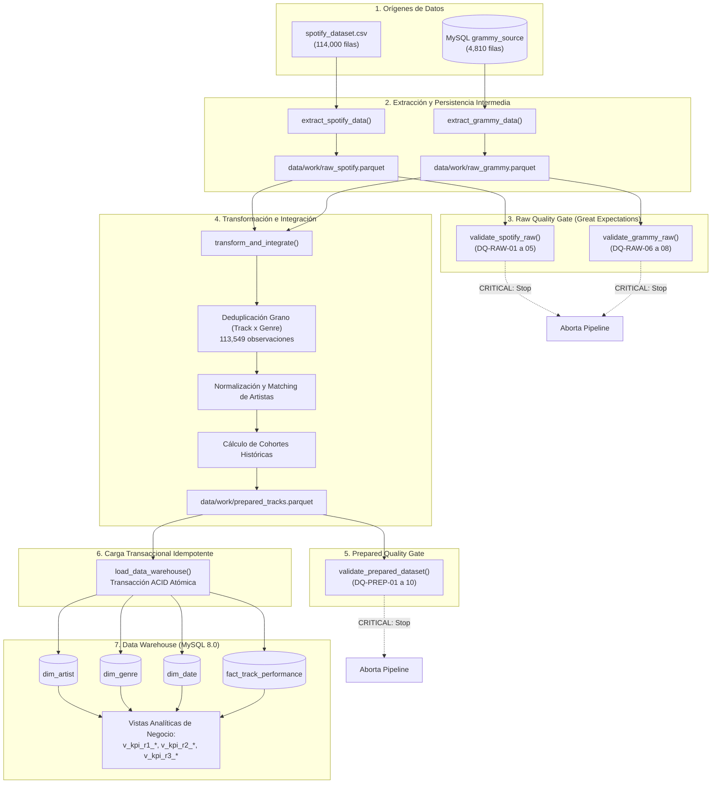

# Workshop 2 — Pipeline ETL Confiable y Data Warehouse para Análisis de Spotify y Grammy Awards

**Curso:** ETL — Ingeniería de Datos e Inteligencia Artificial (G01)  
**Stack Tecnológico:** Apache Airflow 2.8+ / 3.x · Great Expectations 1.x · MySQL 8.0 · Python 3.11+ · Power BI · Docker Compose  
**Repositorio Oficial del Proyecto:** Implementación basada en principios de ingeniería de datos defensiva, resiliencia y confiabilidad (`reliable_pipeline`).

---

## 1. Problema y Objetivo Analítico

La industria musical contemporánea opera en un ecosistema híbrido donde conviven dos dinámicas de validación artística y comercial:
1. **Reconocimiento Institucional Histórico:** Representado por las premiaciones de los *Grammy Awards*, seleccionadas por paneles de la Recording Academy desde 1958.
2. **Consumo Digital Masivo y Popularidad Algorítmica:** Representado por las métricas de *streaming* y atributos acústicos cuantificados por la plataforma de *Spotify*.

El objetivo primordial de este proyecto es construir un **pipeline ETL robusto, resiliente y altamente confiable** que integre de manera limpia ambas fuentes de datos heterogéneas, garantizando la calidad en cada etapa mediante *Quality Gates* automatizados con Great Expectations, y cargando un modelo dimensional en estrella en MySQL 8.0 para responder con rigor estadístico y visual a las preguntas analíticas de negocio a través de Power BI.

---

## 2. Requisitos Analíticos de Negocio (Congelados en Fase 0)

| ID | Requisito Analítico | Pregunta de Negocio | Datos Requeridos | Métrica / KPI Clave | Fuentes |
|---|---|---|---|---|---|
| **REQ-01** | Impacto del Reconocimiento Grammy en la Popularidad | ¿Existe una asociación entre el reconocimiento registrado en los Grammy Awards y la popularidad de los artistas en Spotify, y cómo varía esta relación según el género musical y la cantidad de reconocimientos? | `artist`, `popularity`, `track_genre`, `grammy_nominations`, `grammy_wins` | *Popularity Lift*, Promedio de Popularidad por Nivel de Nominación y Género | Spotify + Grammy |
| **REQ-02** | Características Musicales Predominantes | ¿Cuáles son las características musicales predominantes en las canciones de Spotify asociadas con artistas reconocidos en los Grammy y cómo varían según el género musical? | `danceability`, `energy`, `speechiness`, `acousticness`, `instrumentalness`, `liveness`, `valence`, `tempo`, `track_genre`, `has_grammy` | Perfil Multidimensional de Audio, Diferenciales Normalizados por Género | Spotify + Grammy |
| **REQ-03** | Persistencia Histórica y Comparación frente al Grupo Control | ¿Los artistas con reconocimiento registrado en los Grammy presentan una mayor popularidad en Spotify que los artistas sin reconocimiento registrado, o los artistas del grupo de comparación alcanzan niveles de popularidad iguales o superiores? | `popularity`, `has_grammy`, `first_grammy_decade` | *High Popularity Share* ($HPS_{P75}$ con umbral $\ge 50.0$), *Cohort Persistence Index* (CPI), Desviación Estándar | Spotify + Grammy |

---

## 3. Fuentes de Datos

| Fuente | Naturaleza de los Datos | Formato y Volumen Original | Método de Extracción en Pipeline | Destino Intermedio |
|---|---|---|---|---|
| **Spotify Dataset** | Catálogo de canciones, popularidad y características de audio analizadas por la API de Spotify. | `spotify_dataset.csv`<br/>114,000 registros × 21 columnas | Extracción mediante script Python (`src/extract.py`) con resolución dinámica de rutas. | `data/work/raw_spotify.parquet` |
| **The Grammy Awards** | Registro histórico de nominaciones y premios de la Recording Academy (1958 a 2019). | `the_grammy_awards.csv`<br/>4,810 registros × 5 columnas | Pre-carga en base de datos transaccional origen `grammy_source.grammy_awards_raw` y extracción vía consulta SQL SQLAlchemy. | `data/work/raw_grammy.parquet` |

> **Nota Metodológica de Extracción:** El archivo `the_grammy_awards.csv` se carga como réplica transaccional en `grammy_source.grammy_awards_raw` mediante `scripts/load_grammy_source.py`. El pipeline ETL extrae desde esta base relacional, simulando con fidelidad un entorno de ingesta empresarial.

---

## 4. Arquitectura del Pipeline ETL

El pipeline implementa una arquitectura desacoplada por capas con almacenamiento intermedio en formato columnar binario **Parquet**, eliminando el acoplamiento de memoria y protegiendo el Data Warehouse mediante compuertas de calidad estrictas (*Quality Gates*):



---

## 5. Hallazgos del Data Profiling

El perfilamiento estadístico y estructural de los datos se encuentra documentado y ejecutable en el notebook [`notebooks/data_profiling.ipynb`](file:///c:/Users/mauri/OneDrive/Escritorio/etl/workshop_2/notebooks/data_profiling.ipynb) y sustentado en las figuras generadas en `docs/evidence/`:

1. **Estructura y Granularidad de Spotify:**
   - El dataset contiene 114,000 registros con 21 atributos.
   - Existen **451 duplicados técnicos exactos** para la combinación `(track_id, track_genre)`. Al deduplicar por esta clave compuesta, se obtienen exactamente **113,549 observaciones**.
   - Preservar el grano **Track × Genre** es mandatorio: una misma canción (e.g. acústica/pop) pertenece legítimamente a múltiples categorías de escucha.
2. **Distribución de Popularidad y Umbral P75 (REQ-03):**
   - Mínimo: 0, Máximo: 100.
   - Percentiles: $P_{25} = 17.0$, Mediana ($P_{50}$) = 35.0, **Tercer Cuartil ($P_{75}$) = 50.0**, $P_{90} = 63.0$.
   - **Definición de Alta Popularidad ($HPS_{P75}$):** Se define formalmente como toda canción con `popularity >= 50.0`.
3. **Estructura del Dataset de los Grammy Awards:**
   - Contiene 4,810 registros históricos que abarcan **62 años ininterrumpidos de premiaciones (1958 a 2019)**, lo que permite un análisis longitudinal de cohortes por décadas (1960s a 2010s).
   - 1,840 registros (38.2%) corresponden a categorías técnicas, álbumes o de producción donde la columna `artist` es nula; estas categorías son excluidas del cruce de artistas pero documentadas como limitación de fuente.

---

## 6. Riesgos de Calidad y Reglas de Calidad

| Regla ID | Capa / Dataset | Atributo Validado | Dimensión de Calidad | Regla de Validación | Umbral / Condición | Severidad | Requisito Relacionado |
|---|---|---|---|---|---|---|---|
| **DQ-RAW-01** | Spotify Raw | Tabla completa | Conformidad | Conteo de columnas exacto | 21 columnas | `CRITICAL` | Todos |
| **DQ-RAW-02** | Spotify Raw | Tabla completa | Completitud | Rango de volumen de filas | [100,000, 150,000] filas | `CRITICAL` | Todos |
| **DQ-RAW-03** | Spotify Raw | `popularity` | Validez | Rango admisible de métrica | [0, 100] | `CRITICAL` | REQ-01, REQ-03 |
| **DQ-RAW-04** | Spotify Raw | `explicit` | Conformidad | Conjunto de valores booleanos | {True, False, 0, 1} | `CRITICAL` | Segmentación |
| **DQ-RAW-05** | Spotify Raw | `track_name` | Completitud | No nulos tolerables | $\le 1\%$ de nulos | `WARNING` | REQ-01, REQ-02 |
| **DQ-RAW-06** | Grammy Raw | Tabla completa | Conformidad | Conteo de columnas exacto | 5 columnas | `CRITICAL` | REQ-01, REQ-03 |
| **DQ-RAW-07** | Grammy Raw | Tabla completa | Completitud | Rango de volumen de filas | [4,000, 6,000] filas | `CRITICAL` | REQ-01, REQ-03 |
| **DQ-RAW-08** | Grammy Raw | `year` | Validez | Rango temporal histórico | [1958, 2025] | `CRITICAL` | REQ-03 |
| **DQ-PREP-01**| Prepared Data | Tabla completa | Conformidad | Columnas preparadas requeridas | 24 columnas | `CRITICAL` | Todos |
| **DQ-PREP-02**| Prepared Data | Tabla completa | Completitud | Volumen consolidado post-limpieza| [100,000, 120,000] filas | `CRITICAL` | Todos |
| **DQ-PREP-03**| Prepared Data | `track_id` | Integridad | No nulo | 100% no nulo | `CRITICAL` | Todos |
| **DQ-PREP-04**| Prepared Data | `artist_id` | Integridad | Clave foránea de artista | 100% no nulo | `CRITICAL` | Todos |
| **DQ-PREP-05**| Prepared Data | `genre_name` | Integridad | Clave foránea de género | 100% no nulo | `CRITICAL` | REQ-01, REQ-02 |
| **DQ-PREP-06**| Prepared Data | `popularity` | Validez | Rango de métrica | [0, 100] | `CRITICAL` | REQ-01, REQ-03 |
| **DQ-PREP-07**| Prepared Data | `danceability` | Validez | Normalización acústica | [0.0, 1.0] | `CRITICAL` | REQ-02 |
| **DQ-PREP-08**| Prepared Data | `energy` | Validez | Normalización acústica | [0.0, 1.0] | `CRITICAL` | REQ-02 |
| **DQ-PREP-09**| Prepared Data | `(track_id, genre_name)` | Unicidad | Unicidad del grano dimensional | 0 duplicados | `CRITICAL` | Todos |
| **DQ-PREP-10**| Prepared Data | `has_grammy` | Conformidad | Indicador binario | {0, 1} | `CRITICAL` | REQ-01, REQ-03 |

---

## 7. Diseño de Validaciones con Great Expectations

El módulo `src/validation.py` utiliza la API moderna de **Great Expectations 1.x**:
- **Modo de Contexto:** Efímero en memoria (`gx.get_context(mode='ephemeral')`), garantizando portabilidad absoluta sin dependencias de carpetas ocultas en Docker.
- **Data Source y Batch Definitions:** Conexión mediante `add_pandas()` y definición de lotes completos de DataFrames (`add_batch_definition_whole_dataframe()`).
- **Persistencia de Evidencias:** Cada ejecución de validación guarda un resumen JSON serializable en `data/output/gx_results/` y genera una copia idéntica e inmutable en `docs/evidence/`.
- **Clasificación Semántica de Severidad:**
  - `FailureSeverity.CRITICAL`: Detiene el pipeline de inmediato lanzando `AirflowFailException` o `ValueError`, impidiendo que datos corruptos lleguen al DW.
  - `FailureSeverity.WARNING`: Registra la anomalía con nivel de alerta en los logs de auditoría sin interrumpir el proceso de negocio.

---

## 8. Estrategia de Transformación e Integración

1. **Deduplicación por Grano Dimensional:** Se eliminan duplicados exactos sobre `(track_id, track_genre)`, reteniendo 113,549 registros íntegros.
2. **Normalización de Entidades de Artista:**
   - Se procesa la cadena de artistas delimitada por punto y coma (`;`), extrayendo el artista principal y normalizándolo (minúsculas, remoción de signos ortográficos y espacios duplicados).
3. **Mapeo de Familias y Métricas de Premiaciones:**
   - Se agregan las nominaciones y premios por artista desde el dataset histórico de Grammy.
   - Se mapean las categorías de premiación a familias sonoras homogéneas (Pop, Rock, R&B, Rap, Country, Jazz, Classical, Latin, Dance/Electronic).
   - Se calcula la década de consagración inicial: `first_grammy_decade = (min(year) // 10) * 10`.
4. **Cruce (Left Join Defensivo):**
   - Spotify actúa como dataset maestro. A las canciones sin registro en Grammy se les asigna explícitamente: `has_grammy = 0`, `grammy_nominations = 0`, `grammy_wins = 0`, `first_grammy_decade = NULL`.

---

## 9. Modelo Dimensional (Star Schema)

El modelo dimensional implementa un **Esquema en Estrella** optimizado para consultas analíticas OLAP de alto rendimiento:

```
                  +-------------------------+
                  |        dim_date         |
                  +-------------------------+
                  | PK date_sk              |
                  |    year_number          |
                  |    decade               |
                  +-------------------------+
                               |
                               | 1
                               |
                               | *
+-------------------+     +-------------------------+     +-------------------+
|    dim_artist     |     |  fact_track_performance |     |     dim_genre     |
+-------------------+     +-------------------------+     +-------------------+
| PK artist_sk      | 1   | PK,FK track_id          |   1 | PK genre_sk       |
|    artist_id      |-----* PK,FK genre_sk          |*----|    genre_name     |
|    artist_name    |     | FK    artist_sk         |     +-------------------+
|    has_grammy     |     | FK    date_sk           |
|    total_awards   |     |       popularity        |
|    total_noms     |     |       danceability      |
|    first_decade   |     |       energy            |
+-------------------+     |       loudness          |
                          |       valence           |
                          |       tempo             |
                          |       duration_ms       |
                          +-------------------------+
```

### Vistas Analíticas Precomputadas para Power BI:
- `v_kpi_r1_grammy_vs_popularity`: Popularidad promedio desglosada por condición Grammy y niveles de nominación (0, 1-2, 3-5, 6-10, >10).
- `v_kpi_r1_genre_popularity_lift`: Métrica de elevación de popularidad (*Popularity Lift*) calculada para cada género musical.
- `v_kpi_r2_audio_features_by_grammy_genre`: Comparación promedio de las 9 características acústicas por condición de reconocimiento y género.
- `v_kpi_r3_historical_cohorts_performance`: Rendimiento analítico por cohorte de década inicial del Grammy, porcentaje de temas en el cuartil superior ($HPS_{P75}$) e índice de persistencia de cohorte (CPI).
- `v_kpi_artist_summary`: Vista detallada por artista para segmentadores dinámicos.

---

## 10. Diseño del DAG en Apache Airflow

- **Identificador del DAG:** `spotify_grammy_reliable_etl`
- **Ubicación:** [`dags/reliable_music_pipeline_dag.py`](file:///c:/Users/mauri/OneDrive/Escritorio/etl/workshop_2/dags/reliable_music_pipeline_dag.py)
- **Parámetros del DAG:**
  - `schedule_interval`: `@daily` (con ejecución manual para cargas históricas).
  - `catchup`: `False`.
  - `max_active_runs`: 1.
- **Topología de Tareas y Política de Reintentos:**
  - `extract_spotify_task` (retries: 2, delay: 1m)
  - `extract_grammy_task` (retries: 2, delay: 1m)
  - `validate_raw_spotify_task` (retries: 0 — proceso determinista de calidad)
  - `validate_raw_grammy_task` (retries: 0)
  - `transform_integrate_task` (retries: 0 — computación pura sin efectos colaterales)
  - `validate_prepared_task` (retries: 0)
  - `load_dw_task` (retries: 2, delay: 2m — operaciones de I/O en base de datos)

---

## 11. Política de Fallos y Reintentos

1. **Determinismo vs. Transitoriedad:**
   - Las tareas de validación y transformación son funciones deterministas sobre datasets específicos: si fallan por datos corruptos, reintentar no corregirá los datos. Por ello tienen `retries = 0`.
   - Las tareas de lectura de archivos o conexiones de red a bases de datos pueden sufrir intermitencias temporales: disponen de 2 reintentos espaciados con `retry_delay`.
2. **Severidad y Aislamiento:**
   - Cualquier violación de severidad `CRITICAL` en los *Quality Gates* detiene inmediatamente la ejecución lanzando `AirflowFailException`.
   - Airflow marca la tarea como `FAILED` y, debido a las dependencias ascendentes, omite (*skips*) o bloquea todas las tareas subsiguientes, evitando que datos defectuosos alteren las tablas del DW.

---

## 12. Estrategia de Repetibilidad (Idempotencia)

En motores relacionales como MySQL, `TRUNCATE TABLE` emite un commit DDL implícito, anulando cualquier capacidad de realizar un `ROLLBACK` ante un fallo parcial en medio de la carga.

Para lograr **idempotencia rigurosa y transaccionalidad ACID**:
1. El script `src/load.py` opera dentro de un bloque atómico `with engine.begin() as conn:`.
2. Las tablas son limpiadas mediante `DELETE FROM` respetando la integridad referencial.
3. Se cargan ordenadamente las dimensiones (`dim_artist`, `dim_genre`, `dim_date`) y luego la tabla de hechos `fact_track_performance`.
4. Si ocurre cualquier interrupción o error durante el proceso de inserción, SQLAlchemy ejecuta un `ROLLBACK` total, restaurando la base de datos al estado previo sin tablas a medio llenar.
5. Ejecutar el pipeline $N$ veces sobre el mismo lote produce exactamente el mismo resultado final con cero duplicados.

---

## 13. Tablero y Salidas Analíticas (Power BI)

El informe analítico está documentado en [`docs/power_bi_dashboard.md`](file:///c:/Users/mauri/OneDrive/Escritorio/etl/workshop_2/docs/power_bi_dashboard.md):
- **Conexión:** DirectQuery o Import conectando a `localhost:3307`, base de datos `spotify_grammy_dw`.
- **Estructura de 3 Páginas de Reporte:**
  1. *Página 1 (REQ-01):* Impacto Grammy & Popularidad por Género (KPIs de Popularity Lift, barras por nivel de nominación y matriz por género).
  2. *Página 2 (REQ-02):* Características Musicales Predominantes (Gráficos comparativos de las 9 dimensiones de audio entre grupo Grammy y grupo control).
  3. *Página 3 (REQ-03):* Cohortes Históricas y Persistencia de Popularidad (Línea temporal de cohortes por década, tasa de superación del umbral $P_{75}=50.0$ e índice CPI).

---

## 14. Instrucciones de Configuración y Ejecución

### Requisitos Previos:
- Docker Desktop instalado y en ejecución.
- Python 3.11+ instalado localmente (para scripts auxiliares).
- Git instalado.

### Paso a Paso para Despliegue Completo:

```bash
# 1. Clonar el repositorio y acceder a la carpeta
cd c:\Users\mauri\OneDrive\Escritorio\etl\workshop_2

# 2. Configurar variables de entorno
# Copiar plantilla y verificar contraseñas
cp .env.example .env

# 3. Instalar dependencias en el entorno Python local
pip install -r requirements.txt

# 4. Iniciar la infraestructura de contenedores Docker
docker compose up -d --build

# 5. Pre-cargar el origen transaccional de Grammy Awards
python scripts/load_grammy_source.py

# 6. Ejecución del Pipeline en Airflow (Test A):
# - Abrir navegador en http://localhost:8080
# - Credenciales: usuario 'airflow' / contraseña 'airflow'
# - Activar y disparar manualmente el DAG 'spotify_grammy_reliable_etl'
# - Verificar que todas las tareas culminen exitosamente en verde
```

> **Ejecución Local Rápida (Sin Docker):**
> Para verificar el pipeline completo de manera directa y generar las evidencias forenses, se puede ejecutar:
> ```bash
> python scripts/run_pipeline_local.py
> ```

---

## 15. Evidencias de Pruebas (Test A, Test B, Test C)

El detalle completo de las pruebas ejecutadas con trazabilidad verificable está disponible en [`docs/evidence/test_execution_report.md`](file:///c:/Users/mauri/OneDrive/Escritorio/etl/workshop_2/docs/evidence/test_execution_report.md):

| Prueba | Descripción Operativa | Resultado de la Ejecución | Evidencia Generada |
|---|---|---|---|
| **Test A: Corrida Exitosa** | Extracción íntegra, evaluación de Quality Gates (17/17 aprobadas, 1 advertencia tolerada), transformación de 113,549 registros y carga atómica en MySQL DW. | **100% Exitoso** | [`test_a_successful_run_evidence.json`](file:///c:/Users/mauri/OneDrive/Escritorio/etl/workshop_2/docs/evidence/test_a_successful_run_evidence.json) |
| **Test B: Falla Controlada** | Inyección de registro anómalo (`popularity = 150.0`) con `scripts/create_bad_data.py`. Gate de calidad detecta `CRITICAL`, detiene el pipeline y bloquea la carga al DW. | **100% Bloqueado (Defensivo)** | [`test_b_controlled_failure_evidence.json`](file:///c:/Users/mauri/OneDrive/Escritorio/etl/workshop_2/docs/evidence/test_b_controlled_failure_evidence.json) |
| **Test C: Reejecución Segura** | Restablecimiento de datos y reejecución sobre DW previamente poblado. Conteo final idéntico: 113,549 filas. Cero duplicados. | **100% Idempotente** | [`test_c_safe_rerun_evidence.json`](file:///c:/Users/mauri/OneDrive/Escritorio/etl/workshop_2/docs/evidence/test_c_safe_rerun_evidence.json) |

---

## 16. Supuestos y Limitaciones

1. **Extracción del Artista Principal:** Para colaboraciones múltiples (e.g. `"Lady Gaga;Bradley Cooper"`), el cruce con los registros de premiación se realiza considerando al primer artista listado (`"Lady Gaga"`).
2. **Registros Técnicos en Grammy Awards:** De los 4,810 registros históricos de los Grammy, 1,840 filas (38.2%) corresponden a categorías de ingeniería, mezcla o composición de álbum donde no se registra un artista específico. Estas filas no se vinculan al catálogo de Spotify pero son preservadas como metadatos de auditoría.
3. **Sensibilidad de Ortografía y Coincidencia Exacta:** El matching se realiza mediante normalización alfanumérica en minúsculas sin acentos ni signos ortográficos. Variaciones ortográficas o seudónimos no tipificados pueden clasificarse en el grupo de comparación.
4. **Umbral Estadístico $P_{75}$:** El umbral de alta popularidad está fijado en 50.0 puntos, derivado directamente del tercer cuartil de la distribución empírica de Spotify.

---

## 17. Estructura del Repositorio

```
workshop_2/
├── .env.example                       # Plantilla de variables de entorno seguras
├── .gitignore                         # Exclusión de entornos virtuales, temporales y datos sensibles
├── docker-compose.yaml                # Orquestación de Airflow, MySQL DW, PostgreSQL y dependencias
├── Dockerfile                         # Imagen personalizada de Airflow con dependencias del pipeline
├── README.md                          # Documentación maestra y técnica del proyecto (17 secciones)
├── requirements.txt                   # Dependencias Python (Airflow, Great Expectations 1.x, pyarrow)
├── dags/
│   └── reliable_music_pipeline_dag.py # Definición del DAG resiliente de Apache Airflow
├── data/
│   ├── spotify_dataset.csv            # Fuente cruda de Spotify (114,000 registros)
│   ├── the_grammy_awards.csv          # Fuente cruda de Grammy Awards (4,810 registros)
│   ├── work/                          # Almacenamiento intermedio en formato Parquet
│   └── output/gx_results/             # Resultados de validaciones de Great Expectations
├── docs/
│   ├── architecture.md                # Arquitectura técnica, diagramas y topología del pipeline
│   ├── power_bi_dashboard.md          # Especificación del modelo semántico y medidas DAX
│   └── evidence/                      # Registro inmutable de evidencias forenses y gráficos
│       ├── chart1_popularity_distribution.png
│       ├── chart2_grammy_decades.png
│       ├── chart3_audio_features_comparison.png
│       ├── chart4_genre_popularity_lift.png
│       ├── test_execution_report.md
│       ├── test_a_successful_run_evidence.json
│       ├── test_b_controlled_failure_evidence.json
│       ├── test_b_failed_raw_validation.json
│       ├── test_c_safe_rerun_evidence.json
│       └── load_summary.json
├── notebooks/
│   └── data_profiling.ipynb           # Notebook Jupyter con el perfilamiento exhaustivo de datos
├── scripts/
│   ├── create_bad_data.py             # Script de inyección controlada de anomalías para Test B
│   ├── generate_profiling_charts.py   # Generación de gráficos de evidencia visual
│   ├── generate_profiling_notebook.py # Generación programática del notebook de profiling
│   ├── load_grammy_source.py          # Carga de la réplica transaccional origen en MySQL
│   └── run_pipeline_local.py          # Ejecución y certificación forense de Tests A, B y C
├── sql/
│   ├── analytical_queries.sql         # Consultas analíticas directas para validar REQ-01, 02 y 03
│   └── dw_schema.sql                  # DDL del modelo dimensional en estrella y vistas analíticas
└── src/
    ├── extract.py                     # Módulo de extracción y persistencia intermedia Parquet
    ├── load.py                        # Módulo de carga transaccional e idempotente al DW
    ├── transform.py                   # Módulo de limpieza, deduplicación e integración
    └── validation.py                  # Compuertas de calidad con Great Expectations 1.x
```
