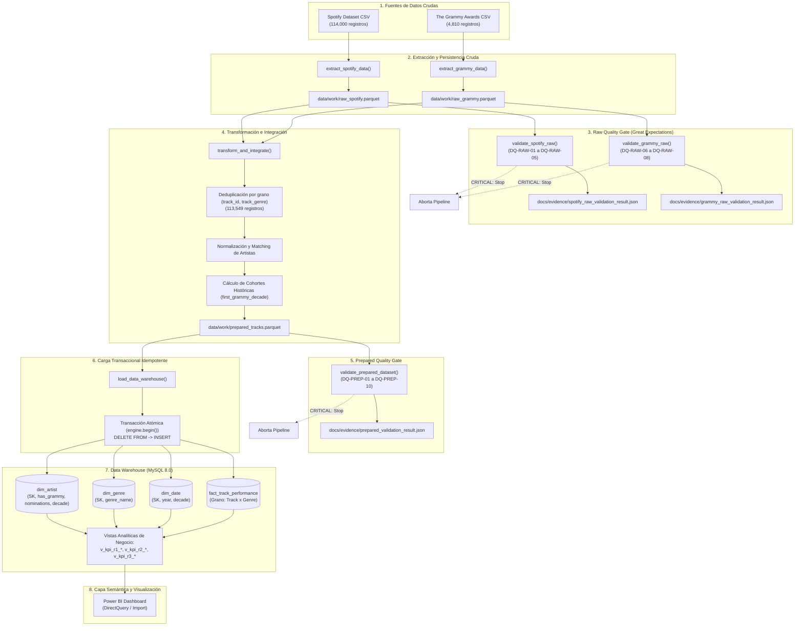
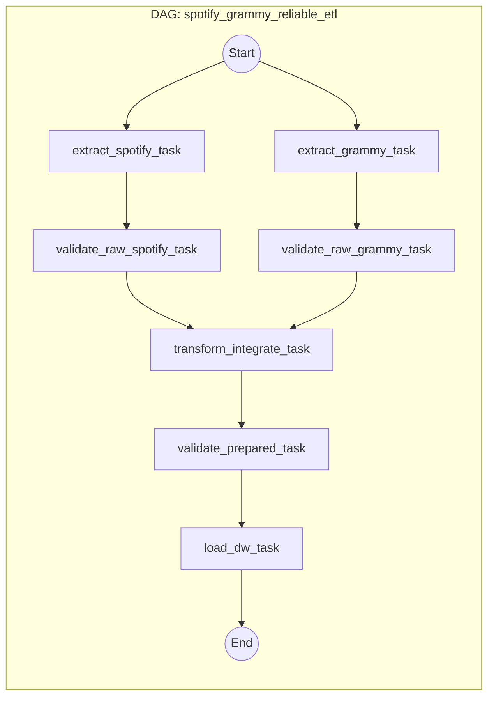

# Arquitectura del Pipeline ETL y Data Warehouse (Workshop 2)

Este documento describe en detalle la arquitectura técnica, metodológica y conceptual del pipeline ETL confiable implementado para el **Workshop 2: Spotify & Grammy Awards Data Warehouse**.

---

## 1. Visión General de la Solución

El pipeline está diseñado bajo los principios de **ingeniería de datos defensiva, resiliencia y confiabilidad** (`reliable_pipeline`), garantizando:
1. **Validación rigurosa de calidad de datos en dos compuertas (Gates)** con Great Expectations 1.x:
   - *Raw Quality Gate*: Validación de esquema, tipos y rangos de las fuentes crudas antes de cualquier transformación.
   - *Prepared Quality Gate*: Validación del dataset integrado antes de proceder a la carga al DW.
2. **Clasificación y manejo de anomalías por severidad**:
   - `CRITICAL`: Aborta la ejecución de forma inmediata para proteger la integridad del Data Warehouse (e.g. popularidad fuera del rango 0-100 o violación de unicidad de clave compuesta).
   - `WARNING`: Registra la advertencia en el log de auditoría y persiste métricas de diagnóstico sin detener el pipeline (e.g. valores nulos tolerables en nombres de canciones).
3. **Persistencia intermedia en formato Parquet**: Desacoplamiento entre fases de extracción, transformación y carga, evitando transferencias masivas de datos por memoria o XCom.
4. **Carga transaccional e idempotente**: Uso de transacciones ACID (`DELETE FROM` dentro de bloques atómicos `engine.begin()`) en MySQL 8.0, asegurando que ante cualquier fallo se produzca un `ROLLBACK` total y que reejecuciones del pipeline no generen duplicados.

---

## 2. Diagrama de Arquitectura de Datos y Componentes

---

## 3. Topología de Apache Airflow (DAG)

El DAG `spotify_grammy_reliable_etl` implementa una topología lineal con ramificaciones de validación y un diseño modular:

### Configuración del DAG
- **Schedule**: `@daily` (o `@once` para carga histórica).
- **Catchup**: `False` (evita detonaciones retroactivas accidentales).
- **Default Args**:
  - `retries`: 1
  - `retry_delay`: `timedelta(minutes=5)`
  - `email_on_failure`: `False`
- **Gestión de Fallos**:
  - Si `validate_raw_spotify_task` o `validate_raw_grammy_task` detectan una anomalía crítica, lanzan `AirflowFailException`, impidiendo la ejecución de `transform_integrate_task`.
  - Si `validate_prepared_task` detecta anomalía crítica, lanza `AirflowFailException`, protegiendo la tarea `load_dw_task`.

---

## 4. Grano del Modelo Dimensional y Estrategia de Carga

### Definición del Grano
El grano de la tabla de hechos `fact_track_performance` es:
> **Un registro por cada combinación única de Canción (Track) y Género Musical.**

- En el dataset crudo de Spotify existen canciones categorizadas simultáneamente en más de un género (e.g. *acoustic*, *folk*, *pop*).
- La deduplicación estricta por `(track_id, track_genre)` elimina 451 duplicados técnicos exactos, preservando exactamente **113,549 observaciones analíticas**.
- La clave primaria de la tabla de hechos es la clave compuesta:
  $$\text{PK} = (\text{track\_id}, \text{genre\_sk})$$

### Transaccionalidad e Idempotencia en MySQL
En motores relacionales como MySQL, `TRUNCATE TABLE` ejecuta un commit implícito DDL, impidiendo el rollback dentro de una transacción activa. Para garantizar transaccionalidad ACID genuina:
1. Se emplea `DELETE FROM` dentro de un contexto `engine.begin()`.
2. Las claves foráneas se desactivan y reactivan controladamente (`SET FOREIGN_KEY_CHECKS = 0; ... SET FOREIGN_KEY_CHECKS = 1;`).
3. Se cargan las dimensiones (`dim_artist`, `dim_genre`, `dim_date`) con claves sustitutas (Surrogate Keys).
4. Se carga la tabla de hechos con mapeo íntegro de dimensiones.
5. Si ocurre cualquier error durante la carga de hechos, SQLAlchemy revierte todas las operaciones anteriores mediante `ROLLBACK`.

---

## 5. Entorno de Ejecución Docker

El entorno se encuentra orquestado en `docker-compose.yaml` mediante 5 servicios intercomunicados:
1. `mysql-dw`: Contenedor MySQL 8.0 dedicado al Data Warehouse analítico (puerto expuesto: 3307).
2. `postgres`: Base de datos PostgreSQL para los metadatos internos de Apache Airflow.
3. `airflow-webserver`: Interfaz web de usuario y monitor de DAGs (puerto 8080).
4. `airflow-scheduler`: Planificador de tareas de Airflow.
5. `airflow-init`: Contenedor de inicialización de migraciones y usuario administrador de Airflow.

Todos los contenedores comparten los volúmenes `./data:/opt/airflow/data`, `./dags:/opt/airflow/dags`, `./src:/opt/airflow/src`, `./sql:/opt/airflow/sql`, y `./docs:/opt/airflow/docs`.
