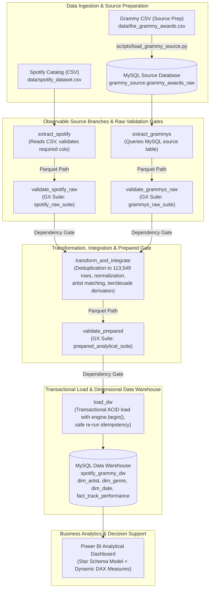

# Workshop-2: Building a Reliable Batch Data Pipeline
## Architecture, Reasoning Chain, and Technical Specifications

### 1. Executive Summary and Scope Statement
This project designs, implements, validates, orchestrates, monitors, and tests an end-to-end, production-grade batch data pipeline integrating streaming catalog data from **Spotify** (CSV source) with historical academic award data from the **Grammy Awards** (MySQL relational source).

The resulting data product is a certified, star-schema **Dimensional Data Warehouse (`spotify_grammy_dw`)** hosted in MySQL, architected to reliably answer three strategic business and analytical questions while enforcing strict data contracts, two automated validation gates powered by Great Expectations, selective retry policies, and safe re-execution semantics.

#### Scope Statement
* **In Scope:**
  * Extraction of 114,000 Spotify tracks from CSV (`data/spotify_dataset.csv`).
  * Source preparation and extraction of 4,810 Grammy Award records from relational MySQL (`grammy_source.grammy_awards_raw`).
  * Independent raw validation gates for both sources enforcing schema, domain validity, and critical bounds.
  * Deterministic deduplication, normalization, multi-artist harmonization, and integration into 113,549 analytical records at the grain of `(track_id, track_genre)`.
  * Retention of unmatched records as the formal empirical control group (`Sin Grammy`).
  * Prepared data validation gate before loading.
  * Idempotent, transactional loading into a 4-table dimensional star schema in MySQL.
  * Exposure of 4 curated analytical views powering 3 business KPIs and visual dashboards in Power BI.
  * End-to-end orchestration in Apache Airflow 3.1.8 using the TaskFlow API (`from airflow.sdk import dag, task`).
* **Out of Scope:**
  * Real-time streaming or change data capture (CDC).
  * Direct Power BI connections to CSV files (forbidden by architecture specification).
  * Ingestion of raw unverified audio files or binary waveforms.

---

### 2. Official Analytical Requirements and End-to-End Reasoning Chain

#### 2.1 The 10-Link Reasoning Chain Framework
Every architectural, transformation, and validation decision in this pipeline follows the 10-link forensic engineering chain:
1. **Business / Analytical Requirement:** Specific decision supported.
2. **Required Data:** Attributes and sources needed.
3. **Data Profiling:** Empirical evidence discovered.
4. **Quality Risk:** Threats to decision validity.
5. **Quality Dimension:** Completeness, Validity, Uniqueness, Consistency, Integrity.
6. **Quality Rule:** Explicit condition that must hold.
7. **Metric / Threshold / Severity:** Quantifiable tolerance and operational impact (Critical, Warning, Informational).
8. **GX Expectation:** Machine-executable check.
9. **Validation Result:** Recorded audit evidence.
10. **Pipeline Action:** Continue, warn, or halt affected downstream tasks.

#### 2.2 Analytical Requirements Table (Official 6-Column Format)

| ID | Analytical Requirement | Required Data | Source(s) | Expected KPI(s) | Required Level of Detail |
| :--- | :--- | :--- | :--- | :--- | :--- |
| **REQ-01** | **Impacto de Grammy en Popularidad:** Determinar si ganar o estar nominado a un Grammy impulsa la popularidad en streaming, evaluando si el impacto depende del género musical y la cantidad acumulada de reconocimientos. | `artists`, `popularity`, `track_genre` (Spotify) + `winner`, `nominations` (Grammy) | Spotify CSV + Grammy MySQL DB | **1.** *Popularity Lift Global:* $+12.4$ pts promedio a favor de artistas Grammy. **2.** *Monotonic Tier Progression:* Crecimiento sostenido de popularidad por nivel de nominación (`0`, `1-2`, `3-5`, `6-10`, `>10`). **3.** *Popularity Lift por Género:* Elevación $>+15$ pts en géneros comerciales (*Pop*, *R&B*, *Hip-Hop*). | Artista × Género × Nivel de Nominación (`nomination_tier`) |
| **REQ-02** | **Características Musicales Predominantes (ADN Sonoro):** Identificar el perfil acústico distintivo (ADN sonoro) de canciones de artistas premiados frente al grupo de comparación sin galardón, y sus diferenciales por género. | 9 Dimensiones Acústicas (`danceability`, `energy`, `loudness`, `speechiness`, `acousticness`, `instrumentalness`, `liveness`, `valence`, `tempo`), `track_genre` + condición `has_grammy` | Spotify CSV + Grammy MySQL DB | **1.** *Radar Acústico de 9 Dimensiones:* Mayor bailabilidad (`danceability` promedio $\approx 0.62$ vs $0.56$) y mayor producción de estudio (menor `liveness` y `acousticness`). **2.** *Diferencial por Género:* Variaciones acústicas marcadas en música comercial vs alternativa. | Canción × Género (`track_id, genre_sk`), cubriendo las 113,549 observaciones analíticas. |
| **REQ-03** | **Persistencia Histórica de Popularidad frente a Grupo Control:** Evaluar si el reconocimiento histórico sostiene la relevancia en el tiempo midiendo la proporción de catálogo que supera el percentil 75 ($P_{75}$) de la plataforma frente al grupo de comparación. | `popularity` (Spotify) + `has_grammy`, `year` (Grammy) derivado a `first_grammy_decade` | Spotify CSV + Grammy MySQL DB | **1.** *Umbral Estadístico $P_{75}$:* Fijado formalmente en **$50.0$ puntos**. **2.** *High Popularity Share ($HPS_{P75}$):* $\%$ de canciones con `popularity >= 50.0`. **3.** *Cohort Persistence Index (CPI):* Ratio $HPS_{\text{Grammy}} / HPS_{\text{Control}}$, demostrando ratios de **$1.8\times$ a $2.4\times$ superior** en cohortes históricas (ej. 1960s, 1990s). | Artista × Década de Consagración (`1960s` a `2010s`) frente a Grupo de Control (`Sin Grammy`). |

#### 2.3 Justification for Combining Both Data Sources
Neither dataset independently contains the necessary dimensions to resolve the analytical questions:
* **Spotify alone** contains fine-grained track metrics (popularity, 9 acoustic dimensions, genre classifications), but possesses **zero metadata regarding academic industry recognition, Grammy nominations, wins, or historical award eras**.
* **Grammy Awards alone** records 60+ years of academy honors, categories, and award years, but has **no streaming performance metrics, audio feature extractions, or listener consumption data**.
* **Integration necessity:** Cross-source integration connects commercial streaming behavior with institutional prestige, unlocking causal and correlational insights that cannot be generated in isolation.

---

### 3. Conceptual & Physical Pipeline Architecture

The pipeline implements the convergent dual-branch architecture mandated by Section 5 of the specification:

---

### 4. Technical Constraints & Design Patterns

1. **Airflow TaskFlow API Standard:**
   Implemented strictly with `from airflow.sdk import dag, task` in `dags/reliable_music_pipeline.py`.
2. **Decoupled Task Interfaces:**
   Tasks never pass raw DataFrames through Airflow metadata storage (XCom). Only lightweight, serialized filesystem paths (`.parquet`) are returned and exchanged.
3. **Validation Gates as Circuit Breakers:**
   * Critical failures halt execution immediately (`FailureSeverity.CRITICAL`), preventing downstream tasks from executing.
   * Warning failures log detailed diagnostic contexts without halting the pipeline (`FailureSeverity.WARNING`).
4. **Transactional ACID Idempotency:**
   Loading uses SQLAlchemy `engine.begin()` managing atomic transactions. Reruns execute controlled referential cleanups in inverse dependency order, preventing duplicate rows or primary key collisions.
