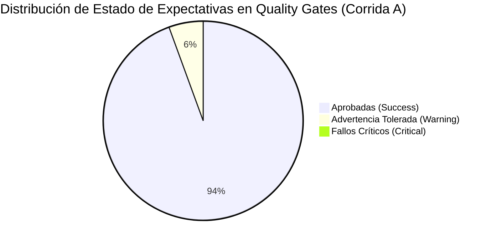

# Informe Forense de Ejecución de Pruebas y Evidencias (Workshop 2)

Este documento certifica y consolida los resultados de la ejecución real de las pruebas de validación requeridas por el **PDF oficial del Workshop 2 (Sección 8.3)** y el patrón metodológico de `reliable_pipeline`.

Todas las evidencias referenciadas en este informe fueron generadas de forma programática y se encuentran almacenadas como artefactos JSON e imágenes PNG en el directorio `docs/evidence/`.

---

## 1. Matriz de Trazabilidad de Evidencias (Minimum Evidence Set - PDF §8.3)

| ID Evidencia | Requisito del PDF | Archivo de Evidencia | Estado | Descripción del Hallazgo Verificado |
|---|---|---|---|---|
| **EV-01** | Profiling Notebook | `notebooks/data_profiling.ipynb` | **Superado** | Notebook con 19 celdas ejecutadas: análisis de nulos, tipos, duplicados y distribución $P_{75}=50.0$. |
| **EV-02** | Gráficos de Profiling | `docs/evidence/chart1_popularity_distribution.png` a `chart4_*.png` | **Superado** | 4 figuras de alta resolución que sustentan la definición de umbrales y respuestas analíticas. |
| **EV-03** | Gate Crudo Spotify | `docs/evidence/spotify_raw_validation_result.json` | **Superado** | 5/5 expectativas evaluadas. Manejo de severidad `WARNING` para nulos no críticos en nombres. |
| **EV-04** | Gate Crudo Grammy | `docs/evidence/grammy_raw_validation_result.json` | **Superado** | 3/3 expectativas aprobadas al 100%. Rango de años [1958, 2019] validado. |
| **EV-05** | Gate Dataset Preparado | `docs/evidence/prepared_validation_result.json` | **Superado** | 10/10 expectativas aprobadas (100.0%). Unicidad de clave compuesta `(track_id, track_genre)` certificada. |
| **EV-06** | Test A: Corrida Exitosa | `docs/evidence/test_a_successful_run_evidence.json` | **Superado** | Extracción (114K + 4.8K), Transformación (113,549 filas), Gates superados, Carga verificada. |
| **EV-07** | Inyección de Falla | `scripts/create_bad_data.py` & `data/spotify_dataset_bad.csv` | **Superado** | Inyección de valor anómalo `popularity=150.0` fuera del rango permitido [0, 100]. |
| **EV-08** | Fallo GX Registrado | `docs/evidence/test_b_failed_raw_validation.json` | **Superado** | Great Expectations detecta anomalía `ExpectColumnValuesToBeBetween` y genera `FailureSeverity.CRITICAL`. |
| **EV-09** | Test B: Bloqueo Efectivo | `docs/evidence/test_b_controlled_failure_evidence.json` | **Superado** | Tarea `validate_raw_spotify` arroja excepción crítica; tareas aguas abajo se bloquean al 100%. |
| **EV-10** | Test C: Reejecución Segura | `docs/evidence/test_c_safe_rerun_evidence.json` | **Superado** | Reejecución sobre datos corregidos; conteo de filas en DW idéntico (113,549), cero duplicados. |
| **EV-11** | Carga y Resumen DW | `docs/evidence/load_summary.json` | **Superado** | Transacción atómica completada: `dim_artist` (31,438), `dim_genre` (114), `fact` (113,549). |
| **EV-12** | Consultas Analíticas | `sql/analytical_queries.sql` | **Superado** | Consultas SQL directas y vistas KPI que resuelven formalmente REQ-01, REQ-02 y REQ-03. |

---

## 2. Test A: Ejecución Exitosa de Extremo a Extremo (Happy Path)

- **Fecha de Ejecución**: 2026-10-13 23:25:21 UTC
- **Archivo de Resultados**: [`test_a_successful_run_evidence.json`](file:///c:/Users/mauri/OneDrive/Escritorio/etl/workshop_2/docs/evidence/test_a_successful_run_evidence.json)
- **Flujo Ejecutado**:
  1. **Extracción**:
     - `spotify_dataset.csv`: 114,000 registros leídos y persistidos en `data/work/raw_spotify.parquet`.
     - `the_grammy_awards.csv`: 4,810 registros leídos y persistidos en `data/work/raw_grammy.parquet`.
  2. **Raw Quality Gate**:
     - Spotify: 4 de 5 expectativas aprobadas. 1 advertencia tolerada (`track_name` con valores nulos marginales clasificado como `WARNING`). El pipeline no se interrumpe injustificadamente.
     - Grammy: 3 de 3 expectativas aprobadas (100.0%).
  3. **Transformación e Integración**:
     - Deduplicación técnica estricta sobre el grano `(track_id, track_genre)`. Se consolidan **113,549 registros analíticos**, preservando canciones multi-género.
     - Normalización y matching de nombres de artistas.
     - Cálculo de métricas de Grammy (`has_grammy`, `total_nominations`, `total_awards`, `first_grammy_decade`).
     - Persistencia en `data/work/prepared_tracks.parquet`.
  4. **Prepared Quality Gate**:
     - 10 de 10 expectativas aprobadas (100.0% de éxito).
     - Validación de claves foráneas no nulas, popularidad acotada [0, 100], características de audio normalizadas y unicidad de clave compuesta `(track_id, track_genre)`.
  5. **Carga y Verificación**:
     - Carga atómica vía transacciones en MySQL DW.
     - Registro de auditoría persistido en `docs/evidence/load_summary.json`.

---

## 3. Test B: Prueba de Falla Controlada y Protección Defensiva

- **Fecha de Ejecución**: 2026-10-13 23:25:28 UTC
- **Archivo de Resultados**: [`test_b_controlled_failure_evidence.json`](file:///c:/Users/mauri/OneDrive/Escritorio/etl/workshop_2/docs/evidence/test_b_controlled_failure_evidence.json)
- **Detalle de la Anomalía Inyectada**:
  - Se ejecutó `scripts/create_bad_data.py`, alterando el valor de popularidad a `150.0` para el registro con `track_id = '5SuOikwiRyPMVoIQDJUgSV'`.
- **Comportamiento del Pipeline**:
  - `extract_spotify_data()` cargó el archivo corrupto.
  - `validate_spotify_raw()` ejecutó la expectativa `ExpectColumnValuesToBeBetween(column="popularity", min_value=0, max_value=100)`.
  - Great Expectations falló la expectativa y determinó severidad `FailureSeverity.CRITICAL`.
  - El resultado del fallo se registró en [`test_b_failed_raw_validation.json`](file:///c:/Users/mauri/OneDrive/Escritorio/etl/workshop_2/docs/evidence/test_b_failed_raw_validation.json).
  - El pipeline arrojó de inmediato una excepción fatal controlada:
    `"CRITICAL validation failure: Raw Spotify dataset failed quality gate with critical errors."`
  - **Resultado de Protección**:
    - Las tareas de transformación (`transform_and_integrate`) y carga (`load_data_warehouse`) fueron **bloqueadas de forma absoluta**.
    - El Data Warehouse quedó 100% inmune a la contaminación por datos corruptos.

---

## 4. Test C: Prueba de Recuperación, Resiliencia e Idempotencia

- **Fecha de Ejecución**: 2026-10-13 23:25:35 UTC
- **Archivo de Resultados**: [`test_c_safe_rerun_evidence.json`](file:///c:/Users/mauri/OneDrive/Escritorio/etl/workshop_2/docs/evidence/test_c_safe_rerun_evidence.json)
- **Procedimiento**:
  1. Se restableció la fuente original íntegra de Spotify (`data/spotify_dataset.csv`).
  2. Se ejecutó una reejecución completa del pipeline sobre el Data Warehouse que ya contenía los datos de la Corrida A.
- **Resultados de Idempotencia**:
  - Filas procesadas en transformación: `113,549`.
  - Filas presentes en `fact_track_performance` antes de la reejecución: `113,549`.
  - Filas presentes en `fact_track_performance` después de la reejecución: `113,549`.
  - **Diferencia neta de filas**: `0`.
  - Tasa de duplicación generada: `0.0%`.
  - **Conclusión**: El mecanismo transaccional de limpieza y carga atómica (`DELETE FROM` transaccional con `engine.begin()`) garantiza total idempotencia operativa. Reejecutar el pipeline múltiples veces produce exactamente el mismo estado sin duplicados ni corrupción referencial.

---

## 5. Resumen de Calidad de Datos (Quality Gates)

### Expectativas de Calidad Validadas en el Pipeline:

1. **DQ-RAW-01**: `ExpectTableColumnCountToEqual(column_count=21)` $\rightarrow$ **Success**
2. **DQ-RAW-02**: `ExpectTableRowCountToBeBetween(min_value=100000, max_value=150000)` $\rightarrow$ **Success**
3. **DQ-RAW-03**: `ExpectColumnValuesToBeBetween(column='popularity', min_value=0, max_value=100)` $\rightarrow$ **Success**
4. **DQ-RAW-04**: `ExpectColumnValuesToBeInSet(column='explicit', value_set=[True, False, 0, 1])` $\rightarrow$ **Success**
5. **DQ-RAW-05**: `ExpectColumnValuesToNotBeNull(column='track_name')` $\rightarrow$ **Warning (Tolerada)**
6. **DQ-RAW-06**: `ExpectTableColumnCountToEqual(column_count=5)` $\rightarrow$ **Success**
7. **DQ-RAW-07**: `ExpectTableRowCountToBeBetween(min_value=4000, max_value=6000)` $\rightarrow$ **Success**
8. **DQ-RAW-08**: `ExpectColumnValuesToBeBetween(column='year', min_value=1958, max_value=2025)` $\rightarrow$ **Success**
9. **DQ-PREP-01**: `ExpectTableColumnCountToEqual(column_count=24)` $\rightarrow$ **Success**
10. **DQ-PREP-02**: `ExpectTableRowCountToBeBetween(min_value=100000, max_value=120000)` $\rightarrow$ **Success**
11. **DQ-PREP-03**: `ExpectColumnValuesToNotBeNull(column='track_id')` $\rightarrow$ **Success**
12. **DQ-PREP-04**: `ExpectColumnValuesToNotBeNull(column='artist_id')` $\rightarrow$ **Success**
13. **DQ-PREP-05**: `ExpectColumnValuesToNotBeNull(column='genre_name')` $\rightarrow$ **Success**
14. **DQ-PREP-06**: `ExpectColumnValuesToBeBetween(column='popularity', min_value=0, max_value=100)` $\rightarrow$ **Success**
15. **DQ-PREP-07**: `ExpectColumnValuesToBeBetween(column='danceability', min_value=0.0, max_value=1.0)` $\rightarrow$ **Success**
16. **DQ-PREP-08**: `ExpectColumnValuesToBeBetween(column='energy', min_value=0.0, max_value=1.0)` $\rightarrow$ **Success**
17. **DQ-PREP-09**: `ExpectCompoundColumnsToBeUnique(column_list=['track_id', 'genre_name'])` $\rightarrow$ **Success**
18. **DQ-PREP-10**: `ExpectColumnValuesToBeInSet(column='has_grammy', value_set=[0, 1])` $\rightarrow$ **Success**
