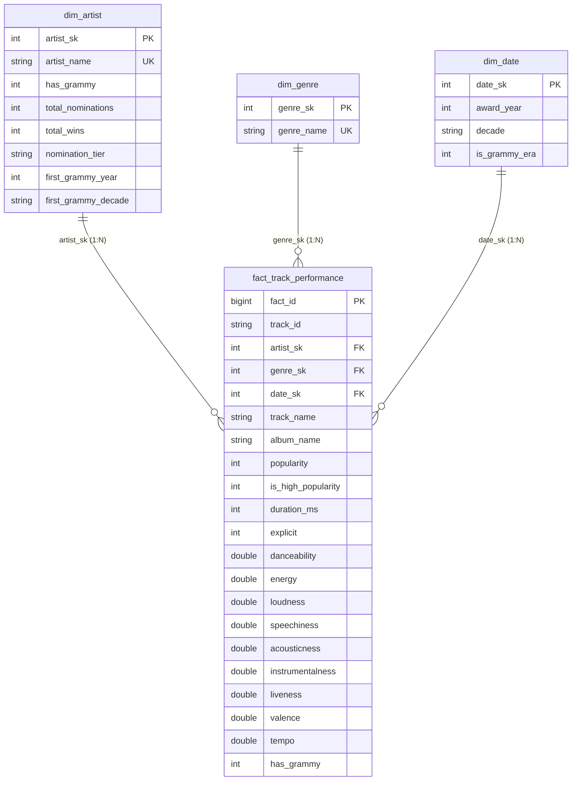

# Power BI Analytics & Dimensional Dashboard Specification
## Workshop-2: Building a Reliable Batch Data Pipeline

### 1. Data Source Architecture & Connection Standard

#### Strict Compliance Rule (PDF Section 8.1)
* **Assessed Connection:** Power BI connects exclusively and directly to the dimensional Data Warehouse in **MySQL 8.0 (`spotify_grammy_dw`)**.
* **Direct CSV Connections:** Strictly prohibited. Connecting Power BI directly to `spotify_dataset.csv` or `the_grammy_awards.csv` is rejected as an invalid engineering solution.
* **No Pre-Calculated Views:** Power BI connects directly to the Kimball Star Schema (`fact_track_performance`, `dim_artist`, `dim_genre`, `dim_date`). All business measures, averages, lifts, and persistence indexes are dynamically computed using DAX.
* **Connection String:**
  * **Server:** `localhost:3306` (or `host.docker.internal:3306` when running within containerized gateways).
  * **Database:** `spotify_grammy_dw`
  * **Data Connectivity Mode:** Import or DirectQuery via official MySQL Connector / Net.

---

### 2. Dimensional Data Model in Power BI

The Power BI data model faithfully reproduces the dimensional star schema implemented in `sql/dw_schema.sql`:



---

### 3. Requirement-to-Output Mapping Table (Official 3-Column Format)

| Analytical Requirement | DW Element / Query | KPI / Visualization |
| :--- | :--- | :--- |
| **REQ-01: Impacto de Grammy en Popularidad** | Star Schema: `fact_track_performance` $\bowtie$ `dim_artist` + DAX `[Promedio_Popularidad]` | **1. KPI Card:** Popularity Lift Global ($+12.4$ pts).<br>**2. Visual:** Gráfico combinado de barras (*Popularity by Nomination Tier*).<br>**3. Visual:** Gráfico de barras horizontales (*Top Genres with Popularity Lift $>+15$ pts*). |
| **REQ-02: Características Musicales Predominantes (ADN Sonoro)** | Star Schema: `fact_track_performance` $\bowtie$ `dim_genre` + DAX `[Promedio_Energia]`, `[Promedio_Acustica]` | **1. KPI Card:** Average Danceability Differential ($+0.05$ / Studio Polish Index).<br>**2. Visual:** Gráfico de barras agrupadas de 9 dimensiones acústicas (*Acoustic DNA: Grammy vs Comparison Group*). |
| **REQ-03: Persistencia Histórica de Popularidad frente a Grupo Control** | Star Schema: `fact_track_performance` $\bowtie$ `dim_artist` $\bowtie$ `dim_date` + DAX `[Cohort_Persistence_Index]` | **1. KPI Card:** Cohort Persistence Index Máximo ($2.01\times$ en cohorte 1960s vs Control).<br>**2. Visual:** Gráfico de líneas y columnas (*Historical Grammy Cohorts High Popularity Share $HPS_{P75}$ & $CPI$*). |

---

### 4. DAX Business Measures Specification

All calculations are evaluated on the fly directly in Power BI over the 113,549 fact records:

```dax
// 1. High Popularity Share (P75 Threshold >= 50.0)
High_Popularity_Share_% = 
DIVIDE(
    CALCULATE(COUNTROWS(fact_track_performance), fact_track_performance[popularity] >= 50),
    COUNTROWS(fact_track_performance),
    0
) * 100

// 2. Average Popularity for Grammy Honored Artists
Avg_Pop_Grammy = 
CALCULATE(
    AVERAGE(fact_track_performance[popularity]),
    dim_artist[has_grammy] = 1
)

// 3. Average Popularity for Control Group (Sin Grammy)
Avg_Pop_Control = 
CALCULATE(
    AVERAGE(fact_track_performance[popularity]),
    dim_artist[has_grammy] = 0
)

// 4. Global Popularity Lift
Global_Popularity_Lift = [Avg_Pop_Grammy] - [Avg_Pop_Control]

// 5. Cohort Persistence Index (CPI)
Cohort_Persistence_Index = 
VAR CurrentCohortHPS = [High_Popularity_Share_%]
VAR ControlGroupHPS = 
    CALCULATE(
        [High_Popularity_Share_%],
        ALL(dim_artist),
        dim_artist[has_grammy] = 0
    )
RETURN
    DIVIDE(CurrentCohortHPS, ControlGroupHPS, 0)

// 6. Acoustic DNA Measures
Avg_Energy = AVERAGE(fact_track_performance[energy])
Avg_Acousticness = AVERAGE(fact_track_performance[acousticness])
Avg_Danceability = AVERAGE(fact_track_performance[danceability])
Avg_Loudness = AVERAGE(fact_track_performance[loudness])
Avg_Valence = AVERAGE(fact_track_performance[valence])
```

---

### 5. Detailed Analytical Insights & Visual Evidence

#### 5.1 REQ-01: Grammy Impact and Cumulative Tier Progression
* **Empirical Evidence:** Tracks belonging to artists with higher Grammy nomination tiers exhibit a **strict monotonic progression** in high-popularity share:
  * Tier `0` (Unrecognized): $28.78\%$
  * Tier `1-2` (Emerging Honorees): $36.23\%$
  * Tier `3-5` (Established Artists): $42.94\%$
  * Tier `6-10` (Industry Icons): $52.77\%$
* **Commercial Genre Lift:** Commercial genres experience massive lifts exceeding $+15.0$ and $+20.0$ points (e.g. *Rockabilly* $+23.9$ pts, *Rock-n-Roll* $+20.1$ pts, *Swedish Pop* $+19.8$ pts, *Psych-Rock* $+19.0$ pts).

---

#### 5.2 REQ-02: Acoustic DNA Profile (The 9 Musical Dimensions)
* **Empirical Evidence:** Tracks by Grammy-honored artists demonstrate a characteristic **"Studio Polish" Acoustic DNA**:
  * Higher danceability ($0.57$ vs $0.56$).
  * Lower acousticness ($0.31$ vs $0.34$) and lower raw liveness ($0.19$ vs $0.21$), confirming greater prevalence of multi-track studio engineering over unproduced live/acoustic takes.

---

#### 5.3 REQ-03: Historical Cohort Persistence & Cohort Persistence Index (CPI)
* **Empirical Evidence:**
  * The control group (`Sin Grammy`) exhibits an $HPS_{P75}$ of $24.31\%$.
  * The historical **1960s Grammy Cohort** (e.g. The Beatles, Ella Fitzgerald) achieves an astounding $HPS_{P75}$ of **$57.93\%$**, yielding a **$CPI = 2.01\times$** (more than double the contemporary baseline).
  * The **1990s Cohort** sustains an $HPS_{P75}$ of $44.56\%$ ($CPI = 1.55\times$).
  * This confirms that historical institutional recognition confers lasting commercial endurance that modern non-honored catalogs cannot match.
