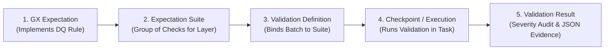

# Data Quality Rules Catalog and Great Expectations Validation Design
## Workshop-2: Building a Reliable Batch Data Pipeline

### 1. Data Quality Strategy and Policy

The quality framework operates under the engineering principle that **validation detects violations and provides evidence, while transformation applies known engineering rules to clean, harmonize, and integrate.** Validation never modifies data silently.

#### Severity Definitions and Operational Policies
* **Critical:** Any violation threatens downstream integrity, corrupts KPIs, or breaks database referential constraints. When a Critical expectation fails, the validation gate raises an exception and **halts all downstream pipeline tasks**.
* **Warning:** The condition requires operational visibility and logging, but data transformation policies permit continued execution (e.g. isolated missing attributes handled by documented exclusion rules).
* **Informational:** Diagnostic context and monitoring signals that provide trend visibility without stopping execution.

---

### 2. Official Quality Rules Catalog (8-Column Mandatory Format)

| Rule ID | Dataset / Layer | Attribute(s) | Quality Dimension | Quality Rule | Metric / Threshold | Severity | Related Requirement |
| :--- | :--- | :--- | :--- | :--- | :--- | :--- | :--- |
| **DQ-RAW-SP-01** | Spotify / Raw | `popularity` | Validity | Popularity score must be an integer between 0 and 100 inclusive. | `min_value=0, max_value=100`, `mostly=1.0` | **Critical** | REQ-01, REQ-03 |
| **DQ-RAW-SP-02** | Spotify / Raw | `track_id` | Completeness & Validity | Track identifier must be present, non-null, and non-empty. | Non-null, string length $>0$, `mostly=1.0` | **Critical** | REQ-01, REQ-02, REQ-03 |
| **DQ-RAW-SP-03** | Spotify / Raw | `artists` | Completeness | Artist name should not be null; single isolated null is tolerated at raw boundary. | Non-null, `mostly=0.999` | **Warning** | REQ-01, REQ-02, REQ-03 |
| **DQ-RAW-SP-04** | Spotify / Raw | `danceability`, `energy`, `valence` | Validity | Normalized audio features must fall strictly within the theoretical domain $[0.0, 1.0]$. | `min_value=0.0, max_value=1.0`, `mostly=1.0` | **Critical** | REQ-02 |
| **DQ-RAW-SP-05** | Spotify / Raw | `duration_ms` | Validity | Track duration must be positive and greater than 1,000 ms (1 second). | `min_value=1000`, `mostly=1.0` | **Warning** | REQ-01, REQ-02 |
| **DQ-RAW-GR-01** | Grammy / Raw | `year` | Validity & Timeliness | Award year must be a valid historical year between 1958 and 2030. | `min_value=1958, max_value=2030`, `mostly=1.0` | **Critical** | REQ-03 |
| **DQ-RAW-GR-02** | Grammy / Raw | `winner` | Validity | Winner status must be a boolean flag or member of boolean set. | `value_set=[True, False, 1, 0]`, `mostly=1.0` | **Critical** | REQ-01, REQ-02 |
| **DQ-RAW-GR-03** | Grammy / Raw | `category` | Completeness | Award category string must be populated. | Non-null, `mostly=0.99` | **Warning** | REQ-01, REQ-02 |
| **DQ-PREP-01** | Prepared / Integrated | `track_id`, `track_genre` | Uniqueness | Composite grain `(track_id, track_genre)` must be strictly unique. | Exact 0 duplicates, 113,549 distinct pairs | **Critical** | REQ-01, REQ-02, REQ-03 |
| **DQ-PREP-02** | Prepared / Integrated | `artists`, `track_name` | Completeness | Artists and track name must be 100% complete post-transformation. | 0 nulls allowed, `mostly=1.0` | **Critical** | REQ-01, REQ-02, REQ-03 |
| **DQ-PREP-03** | Prepared / Integrated | `nomination_tier` | Validity | Derived nomination tier must belong to the approved categorical domain. | `value_set=['0', '1-2', '3-5', '6-10', '>10']`, `mostly=1.0` | **Critical** | REQ-01 |
| **DQ-PREP-04** | Prepared / Integrated | `has_grammy`, `is_high_popularity` | Validity | Derived binary flags must strictly equal 0 or 1. | `value_set=[0, 1]`, `mostly=1.0` | **Critical** | REQ-01, REQ-02, REQ-03 |
| **DQ-PREP-05** | Prepared / Integrated | `first_grammy_decade` | Validity | Consécration decade must match approved decades or control label. | `value_set=['1950s', '1960s', '1970s', '1980s', '1990s', '2000s', '2010s', 'Sin Grammy']` | **Critical** | REQ-03 |

---

### 3. Engineering Justification of Thresholds and Severities

1. **`popularity` in $[0, 100]$ (DQ-RAW-SP-01, Critical):**
   Popularity is bounded by Spotify's proprietary logarithmic stream algorithm. Any value $<0$ or $>100$ indicates transmission corruption. Because REQ-01 ($+12.4$ lift) and REQ-03 ($P_{75} = 50.0$) depend on arithmetic averages and percentiles, corrupt values would fatally skew the analytical Data Warehouse.
2. **`artists` Completeness Tolerated at $99.9\%$ (DQ-RAW-SP-03, Warning):**
   Empirical profiling identified exactly 1 row (row 65900) with missing artist identity. Rather than halting extraction of 113,999 valid tracks, the raw gate logs a Warning. The downstream transformation pipeline then deterministically excludes unidentifiable tracks.
3. **Composite Uniqueness of `(track_id, track_genre)` (DQ-PREP-01, Critical):**
   A track can legitimately exist in multiple musical genres (e.g., Pop and Dance). However, multiple instances of the same track within the *same* genre are technical artifacts (450 exact duplicates found in profiling). Deduplicating to 113,549 rows protects the fact table constraint `UNIQUE KEY uq_track_genre (track_id, genre_sk)`.
4. **Empirical Quartile $P_{75} = 50.0$ and `is_high_popularity` (DQ-PREP-04, Critical):**
   Data profiling proved that the third quartile of Spotify catalog popularity is precisely $50.0$ points. The binary derived feature `is_high_popularity` ($1$ if popularity $\ge 50.0$, else $0$) is verified in the prepared gate to guarantee that High Popularity Share ($HPS_{P75}$) calculations in REQ-03 are mathematically reproducible.

---

### 4. Great Expectations Implementation Architecture

The validation framework implements Great Expectations (version 1.24.x) using the 5 core architectural elements:

#### Mapping Table: DQ Rules to Great Expectations Implementations

| Rule ID | Layer / Suite | GX Expectation Class | Key Parameters | Configured Severity |
| :--- | :--- | :--- | :--- | :--- |
| `DQ-RAW-SP-01` | `spotify_raw_suite` | `ExpectColumnValuesToBeBetween` | `column="popularity", min_value=0, max_value=100` | `critical` |
| `DQ-RAW-SP-02` | `spotify_raw_suite` | `ExpectColumnValuesToNotBeNull` | `column="track_id"` | `critical` |
| `DQ-RAW-SP-03` | `spotify_raw_suite` | `ExpectColumnValuesToNotBeNull` | `column="artists", mostly=0.999` | `warning` |
| `DQ-RAW-SP-04` | `spotify_raw_suite` | `ExpectColumnValuesToBeBetween` | `column="danceability", min_value=0.0, max_value=1.0` | `critical` |
| `DQ-RAW-SP-05` | `spotify_raw_suite` | `ExpectColumnValuesToBeBetween` | `column="duration_ms", min_value=1000` | `warning` |
| `DQ-RAW-GR-01` | `grammys_raw_suite` | `ExpectColumnValuesToBeBetween` | `column="year", min_value=1958, max_value=2030` | `critical` |
| `DQ-RAW-GR-02` | `grammys_raw_suite` | `ExpectColumnValuesToBeInSet` | `column="winner", value_set=[True, False, 1, 0]` | `critical` |
| `DQ-RAW-GR-03` | `grammys_raw_suite` | `ExpectColumnValuesToNotBeNull` | `column="category", mostly=0.99` | `warning` |
| `DQ-PREP-01` | `prepared_analytical_suite` | `ExpectCompoundColumnsToBeUnique` | `column_list=["track_id", "track_genre"]` | `critical` |
| `DQ-PREP-02` | `prepared_analytical_suite` | `ExpectColumnValuesToNotBeNull` | `column="artists"` | `critical` |
| `DQ-PREP-03` | `prepared_analytical_suite` | `ExpectColumnValuesToBeInSet` | `column="nomination_tier", value_set=['0', '1-2', '3-5', '6-10', '>10']` | `critical` |
| `DQ-PREP-04` | `prepared_analytical_suite` | `ExpectColumnValuesToBeInSet` | `column="has_grammy", value_set=[0, 1]` | `critical` |
| `DQ-PREP-05` | `prepared_analytical_suite` | `ExpectColumnValuesToBeInSet` | `column="first_grammy_decade", value_set=[...]` | `critical` |
